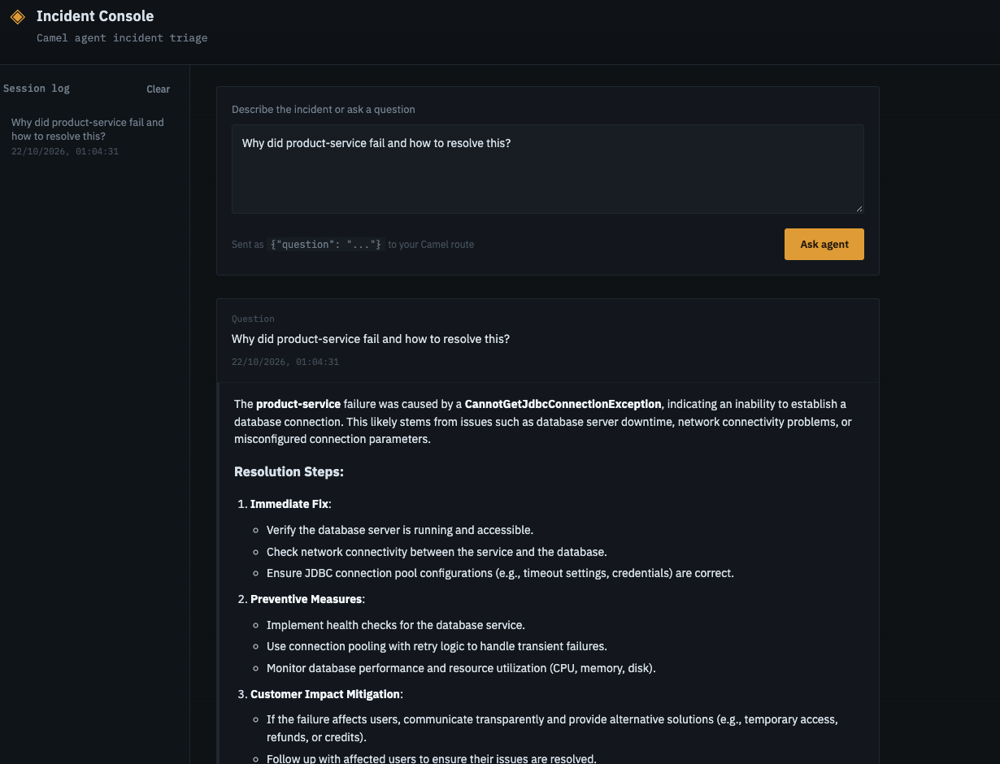

# Building an Agentic RAG Application with Apache Camel and LangChain4j

## Introduction

Large language models (LLMs) can reason about a question, but they do not automatically know an organization's historical production incidents or have access to current external information. Retrieval-Augmented Generation (RAG) addresses this by retrieving relevant information and providing it to the model as context.

**Agentic RAG** adds an agent that can decide which tools to invoke to gather the information needed to answer a question.

In this article, I will walk through an implementation that combines Apache Camel, LangChain4j, Qwen (`qwen3:8b`) running locally through Ollama, Milvus, and web search. The focus is on how Camel components and routes connect these capabilities.

The application gives an AI agent access to tools for searching historical production incidents and retrieving external web information. For a question about a previous failure, the agent can search historical incidents; when more context is needed, it can also use web search. It then uses the results to prepare a consolidated answer.

## Why Apache Camel for AI Integration?

AI applications often need to connect several different systems: a chat model, an embedding model, a vector database, external APIs, and application endpoints. Each system has its own protocol and configuration.

Apache Camel is useful here because it provides a consistent integration model based on endpoints, components, and routes. Instead of writing all integration logic inside one large service, we can express how data moves between systems using Camel routes.

In this application:

- **LangChain4j Embeddings component** converts text into embeddings, both for incident records and for search queries.
- **Milvus component** integrates with the vector database used to store and search historical incidents.
- **AI Tool component** exposes a Camel route as a tool that the agent can call.
- **LangChain4j Agent component** connects the agent configuration with the tools available to it.
- Camel routes define the application flow and help keep the integration logic modular.

This is the main integration benefit: the agent can use capabilities exposed by Camel routes, while each route remains responsible for its specific task.

## High-Level Architecture

The application has two main information sources:

1. **Historical incidents** — incident text is embedded and stored in Milvus. At question time, the query is embedded and compared with stored vectors to retrieve relevant incidents.
2. **External information** — a web-search tool (`tavily_search`) retrieves additional information when the agent decides it is useful.

The agent coordinates these tools and uses the returned results to prepare the final answer.

A request flows through the application like this:

```text
You: "Have we seen this failure before, and is there a recent fix?"
                              |
                              v
               LangChain4j Agent (Qwen via Ollama)
               langchain4j-agent:incident-agent
                              |
             chooses one or both tools by their description
                 |                                   |
                 v                                   v
 ai-tool:search_historical_incidents        ai-tool:tavily_search
          (tag: incident)                        (tag: web)
                 |                                   |
                 v                                   v
 langchain4j-embeddings:query-embedding      Tavily web search API
                 |
                 v
 milvus:historical_incidents
                 |
                 v
 Milvus collection: historical_incidents

              Tool results are returned to the agent
                              |
                              v
        Final answer: related incidents + current external context
```

The model does **not** connect directly to Milvus or to the web. It only sees two named tools, each backed by a Camel route. The routes decide how the embedding is created, how Milvus is queried and how the web search is called.

The agent does not need to execute every tool for every question. It can choose a tool based on the question and the tool descriptions provided to it. The two tools exposed to the agent are:

| Tool | What it does | Input |
|------|--------------|-------|
| `search_historical_incidents` | Semantic search over historical production incidents stored in Milvus | `question` (string, required) |
| `tavily_search` | Searches the current public web for up-to-date information | `query` (string, required) |

Keeping the tools this narrow is deliberate: the agent can only perform the operations that a route explicitly exposes.

## 1. Configuring the Models (Spring Boot Configuration)

Before looking at the routes, it helps to see where the models come from. Camel routes only declare *where* a chat model or an embedding model is used; the models themselves are created once, as Spring beans, in a configuration class called `AgentConfig`. It defines three beans (plus a small startup check):

| Bean name | Type | Purpose |
|-----------|------|---------|
| `incidentChatModel` | `ChatModel` | The chat model the agent uses to reason and call tools |
| `incidentEmbeddingModel` | `EmbeddingModel` | The embedding model that turns incident text and questions into vectors |
| `incidentAgentConfiguration` | `AgentConfiguration` | The agent configuration referenced by the Camel agent endpoint |

### The chat model

```java
@Bean(name = "incidentChatModel")
public ChatModel incidentChatModel() {

   return OpenAiChatModel.builder()
           .baseUrl("http://localhost:11434/v1")
           .apiKey("ollama")
           .modelName("qwen3:8b")
           .temperature(0.2)
           .maxTokens(700)
           .build();
}
```

Ollama exposes an OpenAI-compatible API under `/v1`, so the application can use LangChain4j's `OpenAiChatModel` and simply point it at the local Ollama server instead of OpenAI:

- `baseUrl("http://localhost:11434/v1")` is the local Ollama endpoint (11434 is Ollama's default port).
- `apiKey("ollama")` is a placeholder. Ollama does not validate the key, but the OpenAI client expects a non-empty value.
- `modelName("qwen3:8b")` selects the Qwen 3 model with 8 billion parameters. It must already be pulled in Ollama (`ollama pull qwen3:8b`).
- `temperature(0.2)` keeps the output fairly deterministic, which suits an incident-investigation assistant that should stick to retrieved facts rather than improvise.
- `maxTokens(700)` limits the length of each model response. Adjust it to the level of detail you want in the final answer.

### The embedding model

```java
@Bean(name = "incidentEmbeddingModel")
public EmbeddingModel incidentEmbeddingModel() {

   return OpenAiEmbeddingModel.builder()
           .baseUrl("http://localhost:11434/v1")
           .apiKey("ollama")
           .modelName("nomic-embed-text")
           .build();
}
```

The embedding model uses the same approach: `OpenAiEmbeddingModel` pointed at Ollama, with `nomic-embed-text` as the model (`ollama pull nomic-embed-text`). This is the model behind the `langchain4j-embeddings:query-embedding` step used in the routes later in this article. Because the same model embeds both stored incidents and incoming questions, both live in the same vector space, which similarity search requires.

### The agent configuration

```java
@Bean(name = "incidentAgentConfiguration")
public AgentConfiguration incidentAgentConfiguration(ChatModel incidentChatModel) {

   return new AgentConfiguration()
           .withChatModel(incidentChatModel)
           .withMaxToolCallingRoundTrips(2)
           .withExecuteToolsConcurrently();
}
```

This is the bean that the agent endpoint refers to with `agentConfiguration=#incidentAgentConfiguration` (see section 4). It is built from the following options:

- `withChatModel(incidentChatModel)` gives the agent the Qwen chat model defined above.
- `withMaxToolCallingRoundTrips(2)` limits how many times the agent can go back and forth between the model and its tools for one request. A round trip is: the model asks for one or more tools, the results are returned, and the model continues. Capping this keeps a request from looping on tool calls, which also bounds latency and cost. With two round trips the agent can, for example, search historical incidents and then search the web before it answers.
- `withExecuteToolsConcurrently()` lets the agent run tool calls in parallel when the model requests several in the same step. In this application that means the Milvus search and the web search can run at the same time instead of one after the other.

### Verifying the embedding model at startup

The configuration class also includes a `CommandLineRunner` that prints information about the embedding model when the application starts:

```java
@Bean
public CommandLineRunner verifyEmbeddingModel(EmbeddingModel embeddingModel) {

   return args -> {

      System.out.println("==========================================");
      System.out.println("EmbeddingModel = " + embeddingModel);
      System.out.println("Embedding dimension = " + embeddingModel.dimension());
      System.out.println("==========================================");
   };
}
```

This is a quick sanity check that the embedding model was created and that Ollama is reachable. More importantly, it prints the **embedding dimension**, which must match the `EMBEDDING_DIMENSION` (768) used when the Milvus collection is created in the next section. If you switch to a different embedding model, check this output first and update the collection schema to match.

> **Note:** the `apiKey("ollama")` value and the `localhost` URLs are fine for local development. For a real deployment, move the base URL, model names and any real API keys into `application.properties` (or environment variables) instead of hard-coding them.

## 2. Preparing the Milvus Collection

The first part of the workflow is making historical incidents searchable by meaning rather than only by exact keywords.

A vector database stores numerical representations called **embeddings**. An embedding model converts text into a vector. When a user asks a question, the application creates a query embedding and searches for stored vectors that are similar to it.

For this application, the Milvus collection is named `historical_incidents`. The application uses the Nomic Embed Text model (configured in the previous section) to represent incident content and query text in the same vector space.

Before inserting records, the collection must be created with a schema and vector dimension compatible with the embedding model. The dimension must match the number of values produced by that model. The collection and index configuration should also match the requirements of the Milvus version and the search strategy being used.

### Initializing Milvus with Camel routes

Instead of creating the collection by hand, the application does the setup with Camel routes. Each step is a small route with one job, and one orchestration route runs them in order. The routes share two constants, the collection name and the embedding dimension:

```java
private static final String COLLECTION_NAME = "historical_incidents";
private static final int EMBEDDING_DIMENSION = 768;
```

The dimension is 768 because that is the vector size produced by the embedding model used in this application (Nomic Embed Text). If you use a different embedding model, change this value to match. The startup check in `AgentConfig` prints the dimension reported by the configured model, so you can confirm it.

The setup is exposed through a REST endpoint, so it can be triggered with a single call:

```text
POST /api/milvus/initialize
            |
            v
  direct:initialize-milvus
            |
            v
  direct:create-milvus-collection   (action: CREATE_COLLECTION)
            |
            v
  direct:create-milvus-index        (action: CREATE_INDEX)
            |
            v
  direct:load-milvus-collection     (loads the collection into memory)
            |
            v
  {"status":"SUCCESS","message":"Milvus initialized successfully"}
```

The order matters: the collection must exist before an index can be created on it, and the collection should be indexed and loaded before it is searched. The orchestration route simply calls the three routes in sequence:

```java
restConfiguration().component("servlet").bindingMode(RestBindingMode.json);

rest("/api/milvus")
        .post("/initialize")
        .produces("application/json")
        .to("direct:initialize-milvus");

from("direct:initialize-milvus")
        .routeId("initialize-milvus-api")
        .to("direct:create-milvus-collection")
        .to("direct:create-milvus-index")
        .to("direct:load-milvus-collection")
        .setBody(constant(
        "{\"status\":\"SUCCESS\",\"message\":\"Milvus initialized successfully\"}"));
```

The `log` steps used in the full route are left out here for brevity.

### Step 1: Create the collection

The `create-milvus-collection` route uses the same pattern as the insert step: it sets the Milvus action header, prepares the message body, and sends the exchange to the `milvus` endpoint for the collection.

```java
from("direct:create-milvus-collection")
        .routeId("create-milvus-collection")
        .setHeader(Milvus.Headers.ACTION)
        .constant(MilvusAction.CREATE_COLLECTION)
        .setBody()
        .method(this, "createCollectionParam")
        .to("milvus:" + COLLECTION_NAME);
```

- `MilvusAction.CREATE_COLLECTION` tells the Milvus component to create a collection.
- `setBody().method(this, "createCollectionParam")` sets the message body to the `CreateCollectionParam` object built by the `createCollectionParam` method. This is the Milvus Java SDK object that describes the collection.
- `to("milvus:" + COLLECTION_NAME)` sends the request to the `historical_incidents` collection.

The schema is defined in `createCollectionParam`. It has eight fields:

| Field | Type | Notes |
|-------|------|-------|
| `id` | `Int64` | Primary key, generated automatically by Milvus |
| `incidentDate` | `VarChar` (max 50) | Date when the incident occurred |
| `serviceName` | `VarChar` (max 200) | Service that generated the incident |
| `operation` | `VarChar` (max 200) | Operation being performed |
| `status` | `VarChar` (max 50) | Incident status, for example `FAILED` |
| `exception` | `VarChar` (max 500) | Exception associated with the incident |
| `logs` | `VarChar` (max 5000) | Relevant application logs |
| `embedding` | `FloatVector` (768) | Embedding of the incident, used for similarity search |

The primary key and the vector field are the two most important definitions:

```java
FieldType idField = FieldType.newBuilder()
        .withName("id")
        .withDataType(DataType.Int64)
        .withPrimaryKey(true)
        .withAutoID(true)
        .build();

FieldType embeddingField = FieldType.newBuilder()
        .withName("embedding")
        .withDataType(DataType.FloatVector)
        .withDimension(EMBEDDING_DIMENSION)
        .build();

return CreateCollectionParam.newBuilder()
        .withCollectionName(COLLECTION_NAME)
        .withDescription("Historical failed incidents")
        .withShardsNum(2)
        .addFieldType(idField)
// ... incidentDate, serviceName, operation, status, exception, logs
        .addFieldType(embeddingField)
        .build();
```

Because `withAutoID(true)` is set, the incident records you insert do not need to supply an `id`. The text fields are stored as `VarChar` with a maximum length, and the `embedding` field holds the vector. Its dimension must match the embedding model, as described above.

### Step 2: Create the vector index

A vector index lets Milvus search the `embedding` field efficiently. The `create-milvus-index` route follows the same pattern, with a different action and a different parameter object:

```java
from("direct:create-milvus-index")
        .routeId("create-milvus-index")
        .setHeader(Milvus.Headers.ACTION)
        .constant(MilvusAction.CREATE_INDEX)
        .setBody()
        .method(this, "createEmbeddingIndexParam")
        .to("milvus:" + COLLECTION_NAME);
```

```java
public CreateIndexParam createEmbeddingIndexParam() {
   return CreateIndexParam.newBuilder()
           .withCollectionName(COLLECTION_NAME)
           .withFieldName("embedding")
           .withIndexType(IndexType.AUTOINDEX)
           .withMetricType(MetricType.COSINE)
           .build();
}
```

- `withFieldName("embedding")` builds the index on the vector field.
- `IndexType.AUTOINDEX` lets Milvus choose the index configuration, which keeps the example simple.
- `MetricType.COSINE` makes similarity search compare the angle between vectors, a common choice for text embeddings.

### Step 3: Load the collection

A collection has to be loaded into memory before Milvus can search or query it. The `load-milvus-collection` route is a little different from the other two. It uses a processor and calls the Milvus Java client that is exposed by the Camel endpoint:

```java
from("direct:load-milvus-collection")
        .routeId("load-milvus-collection")
        .process(exchange -> loadCollection());
```

```java
private void loadCollection() {
   MilvusEndpoint endpoint =
           getContext().getEndpoint("milvus:" + COLLECTION_NAME, MilvusEndpoint.class);

   var response = endpoint.getClient().loadCollection(
           LoadCollectionParam.newBuilder()
                   .withCollectionName(COLLECTION_NAME)
                   .build());

   if (response.getStatus() != 0) {
      throw new RuntimeException("Failed to load Milvus collection: " + response.getMessage());
   }
}
```

The method checks the response status and throws an exception if loading fails, so the failure surfaces in the route instead of going unnoticed. This is a useful pattern: Camel handles the endpoint and the route flow, and when you need an operation that is not a header-driven action, you can use the underlying client from the endpoint.

### Verifying the collection

To check that the collection works, the application also has a route that queries it. It is exposed as `GET /api/milvus/incidents`:

```java
rest("/api/milvus")
        .get("/incidents")
        .produces("application/json")
        .to("direct:query-historical-incidents");

from("direct:query-historical-incidents")
        .routeId("query-historical-incidents")
        .setHeader(Milvus.Headers.ACTION)
        .constant(MilvusAction.QUERY)
        .setBody()
        .method(this, "createQueryParam")
        .to("milvus:" + COLLECTION_NAME);
```

```java
public QueryParam createQueryParam() {
   return QueryParam.newBuilder()
           .withCollectionName(COLLECTION_NAME)
           .withExpr("status == \"FAILED\"")
           .withOutFields(Arrays.asList(
                   "id", "incidentDate", "serviceName",
                   "operation", "status", "exception", "logs"))
           .build();
}
```

This is a scalar query, not a vector search. It returns the incidents whose `status` is `FAILED` and lists the fields to return, without the embedding vector. Once records have been inserted, this endpoint is a quick way to confirm that the data is in Milvus before the agent is involved.

### Creating embeddings with the Camel LangChain4j Embeddings component

Milvus stores vectors, not raw text, so each incident must be converted into an embedding before it is inserted. In the Camel route, this is a single step that uses the LangChain4j Embeddings component:

```java
.to("langchain4j-embeddings:query-embedding")
```

Here is what this step does:

- `langchain4j-embeddings` is the Camel component that generates embeddings through LangChain4j.
- `query-embedding` is the endpoint ID. It identifies this embedding endpoint within the route.

The embedding model that actually produces the vectors (Nomic Embed Text running through Ollama) is configured in the application, not in the route: it is the `incidentEmbeddingModel` bean shown in section 1. The route only declares *where* in the flow the text becomes a vector. This keeps the route readable and lets you change the model without rewriting the route.

Using the same embedding model for both stored incidents and incoming questions is important, because similarity search only makes sense when both vectors live in the same vector space.

### Inserting historical incidents with the Camel Milvus component

Once the collection is ready and the incident text has been converted into an embedding, the application can send the record to Milvus using a Camel route.

The following is the core route pattern. It creates the embedding, selects the insert action, and sends the message to the `historical_incidents` collection:

```java
.to("langchain4j-embeddings:query-embedding")
.setHeader(Milvus.Headers.ACTION)
    .constant(MilvusAction.INSERT)
.to("milvus:historical_incidents");
```

Here is what each step does:

- `to("langchain4j-embeddings:query-embedding")` generates the embedding for the incident text.
- `setHeader(Milvus.Headers.ACTION)` sets the action that the Milvus component should perform.
- `constant(MilvusAction.INSERT)` sets that action to `INSERT`.
- `to("milvus:historical_incidents")` sends the exchange to the Milvus endpoint for the `historical_incidents` collection.

The endpoint identifies the target collection, while the message body and any required headers must contain the data expected by the configured Camel Milvus component. In this application, the record must include the vector and the fields required by the collection schema.

This is a useful example of Camel's integration model: the route expresses the operation and destination declaratively, while each component handles communication with its own system, the embedding model in one case and Milvus in the other.

### Loading incidents from a CSV file

The snippet above shows only the core embed-and-insert pattern. In the application, the data comes from a daily status report in CSV format. A file-based route picks the report up, keeps only the failed incidents, embeds each one and inserts it into Milvus. This runs after the collection has been created with `POST /api/milvus/initialize`.

At a high level, the ingestion flow looks like this:

```text
daily_status_report_with_date.csv
            |
            v
  file consumer (daily-status-route)
            |
            v
  unmarshal CSV -> DailyStatusReport objects (Bindy)
            |
            v
  split: one exchange per CSV row
            |
            v
  choice: status == 'FAILED' ?
      |                         |
     yes                       no
      |                         |
      v                         v
  FailedIncidentProcessor    log "Skipping non-FAILED incident"
  (build incident text)
      |
      v
  langchain4j-embeddings:query-embedding
      |
      v
  EmbeddingProcessor (keep the vector)
      |
      v
  direct:insert-historical-incident
      |
      v
  MilvusInsertProcessor -> action INSERT -> milvus:historical_incidents
```

The application is split into two routes. The first one reads and filters the file; the second one only inserts into Milvus.

#### Route 1: Reading and filtering the file

```java
from("{{daily.report.filepath}}?delete=false&fileName=daily_status_report_with_date.csv")
        .routeId("daily-status-route")
        .unmarshal().bindy(BindyType.Csv, DailyStatusReport.class)
        .split(body())
        .choice()
            .when(simple("${body.status} == 'FAILED'"))
        .process(failedIncidentProcessor)
                .to("langchain4j-embeddings:query-embedding")
                .process(embeddingProcessor)
                .to("direct:insert-historical-incident")
            .otherwise()
                .log("Skipping non-FAILED incident: ${body}")
        .end();
```

## 3. Exposing Historical Incident Search as an AI Tool

Storing incidents is only one part of the solution. The agent also needs a way to search those incidents when it decides that historical information is relevant.

The Camel `ai-tool` component can expose a route as a tool for an AI agent. In this application, the tool is named `search_historical_incidents`.

The route definition describes what the tool does and tells the agent which input parameter to supply:

```java
from("ai-tool:search_historical_incidents"
             + "?description=Search historical production incidents using semantic similarity. "
             + "Use this tool when you need historical incident information, previous failures, "
             + "exceptions, logs, services, or operations."
             + "&tags=incident"
             + "&parameter.question.type=string"
             + "&parameter.question.description=The incident or technical question to search for in historical incidents"
             + "&parameter.question.required=true")
    .routeId("ai-tool-search-historical-incidents");

// TODO: Add the remainder of the route that reads the question,
// creates its embedding, searches Milvus, and returns matching incidents.
```

The important parts of this endpoint are:

- **Tool name:** `search_historical_incidents` is the name exposed to the agent.
- **Description:** explains when the tool should be used. A clear description helps the agent select the tool for questions about previous failures, logs, exceptions, services, or operations.
- **Tag:** `incident` categorizes the tool.
- **Parameter:** `question` is a required string containing the user's incident or technical question.
- **Route ID:** `ai-tool-search-historical-incidents` gives the Camel route a stable, readable identifier.

The description is more than documentation for a human reader. It provides the agent with information about the tool's purpose, helping it decide whether the tool is relevant to a question.

### What happens when the agent invokes this tool?

At a high level, the tool receives a question, the application generates an embedding for that question, and the Milvus component searches the `historical_incidents` collection. The matching records are then returned from the tool so the agent can use them in its response.

The query embedding is created the same way as during ingestion: the question passes through the `langchain4j-embeddings` component, so the question and the stored incidents are represented by the same embedding model.

<!-- TODO: Add the complete search route, including the embedding step, Milvus search action, and result mapping. -->

## 4. Connecting the Tool to the LangChain4j Agent

Defining a tool route makes the capability available, but the agent must also be configured to discover and invoke it.

The application uses the Camel LangChain4j Agent component with an agent endpoint in this form:

```java
.to("langchain4j-agent:incident-agent"
            + "?agentConfiguration=#incidentAgentConfiguration"
            + "&tags=incident,web");
```

The endpoint contains three important pieces:

- `langchain4j-agent:incident-agent` identifies the agent endpoint.
- `agentConfiguration=#incidentAgentConfiguration` references the agent configuration bean registered in the application. The `#` prefix tells Camel to look the value up in the registry by bean name, which is why the bean in `AgentConfig` is explicitly named `incidentAgentConfiguration`.
- `tags=incident,web` selects tools associated with the `incident` and `web` tags.

The tags connect the agent configuration to the capabilities made available through the tool routes. The incident tool uses the `incident` tag, and the `tavily_search` web-search tool described in the next section uses the matching `web` tag, so both are available to the agent.

This design keeps the agent configuration separate from individual tool implementations. The agent decides which available tool to call, while the corresponding Camel route performs the integration work.

### What the agent configuration controls

The `incidentAgentConfiguration` bean was shown in section 1. In the context of the agent endpoint, it controls three things:

```java
return new AgentConfiguration()
        .withChatModel(incidentChatModel)
        .withMaxToolCallingRoundTrips(2)
        .withExecuteToolsConcurrently();
```

| Option | Effect on the agent |
|--------|---------------------|
| `withChatModel(incidentChatModel)` | The agent reasons with the local `qwen3:8b` model served by Ollama |
| `withMaxToolCallingRoundTrips(2)` | The agent can go back to its tools at most twice per request, which keeps tool-calling loops bounded |
| `withExecuteToolsConcurrently()` | When the model requests several tools at once, they run in parallel |

Together with the `tags` on the endpoint, this defines the agent's boundaries: which model it uses, which tools it can see, and how much tool calling it may do for a single question.

A few practical points about these settings:

- **Round-trip limit:** a low limit is a safety net. If the agent keeps asking for tools without converging on an answer, the limit stops the loop. If you add more tools and find that answers need more steps, increase it gradually.
- **Concurrent execution:** this helps most when the model asks for both tools in the same step, for example an incident search and a web search for the same question. Make sure your tool routes are safe to run in parallel (they should not depend on shared mutable state).
- **Model size:** an 8B model running locally is a good fit for a demo or an internal tool, but smaller models can be less reliable at choosing tools and filling parameters. Clear tool descriptions, as shown in this article, matter even more with smaller models.

## 5. Adding Web Search as a Second Tool

Historical incident data may not answer every question. For example, an engineer might want to compare an internal failure with a recently reported library issue or consult current technical documentation.

For this, the application exposes a second tool, `tavily_search`, using the same `ai-tool` component. It lets the agent search the current public web:

```java
from("ai-tool:tavily_search"
             + "?tags=web"
             + "&description=Search the current public web for up-to-date information. "
             + "Use this tool for current events, latest releases, recent documentation, news, "
             + "or information that cannot be found in historical incidents."
             + "&parameter.query.type=string"
             + "&parameter.query.description=The web search query"
             + "&parameter.query.required=true");

// TODO: Add the remainder of the route that calls the Tavily API
// and returns the search results to the agent.
```

The structure mirrors the incident-search tool, which is the point of using `ai-tool`: every capability is declared the same way.

- **Tool name:** `tavily_search` is the name exposed to the agent.
- **Tag:** `web` places the tool in a different category from `incident`. Because the agent endpoint is configured with `tags=incident,web`, it can see both tools.
- **Description:** tells the agent when to prefer this tool: current events, latest releases, recent documentation, news, or anything that cannot be found in the historical incidents. The wording also draws a boundary between the two tools, which helps the agent pick the right one.
- **Parameter:** `query` is a required string containing the web search query the agent wants to run.

Note that the two tools use different parameter names: `question` for incident search and `query` for web search. Each parameter name and description is part of what the agent sees, so they should describe the input clearly for that specific tool.

The agent can use this tool on its own for questions about current information, or combine it with historical incident results. For example, it might find a similar past failure in Milvus and then search the web to check whether a recent library release addresses the cause.

<!-- TODO: Add the rest of the tavily_search route: how the query is read from the exchange, how the Tavily API is called, and how the result is returned to the agent. -->

## 6. Putting the Workflow Together

The complete workflow is:

1. A user sends a question to the application.
2. The LangChain4j agent, backed by the `qwen3:8b` chat model, evaluates the question and selects from its available tools.
3. If historical context is useful, the agent invokes `search_historical_incidents`.
4. The Camel route creates the query embedding with `langchain4j-embeddings` (using `nomic-embed-text`) and searches Milvus.
5. If external context is useful, the agent invokes `tavily_search`.
6. The tool results are returned to the agent. If both tools were requested together, they run concurrently.
7. The agent prepares a final answer using the retrieved information, within the configured limit of two tool-calling round trips.

The agent may use one tool or multiple tools depending on the question. The important point is that the application exposes capabilities through explicit tool definitions instead of hard-coding one retrieval sequence for every request.

<!-- TODO: Add a sanitized, real example request and response from the running application. -->

## 7. Exposing the Application Through REST Endpoints

The application exposes REST endpoints for both setup and usage.

Setup and verification (described in section 2):

- `POST /api/milvus/initialize` — creates the collection, creates the index and loads the collection.
- `GET /api/milvus/incidents` — queries the stored `FAILED` incidents.

Search and agent:

- `/incidents/search` — performs a direct historical incident search.
- `/incidents/agent` — submits a question to the agent workflow.

Keeping direct search separate from agent-based question answering makes the system easier to test. The direct endpoint helps validate embeddings and Milvus retrieval independently, while the agent endpoint validates tool selection and response synthesis.

<!-- TODO: Add the actual REST route/controller implementation and example curl requests. -->

## Running the Application Locally

To run the application as described, you need these pieces available locally:

1. **Ollama** running on `localhost:11434`, with both models pulled:
   ```bash
   ollama pull qwen3:8b
   ollama pull nomic-embed-text
   ```
2. **Milvus** running and reachable from the Camel Milvus component.
3. A **Tavily API key** for the web-search tool.
4. Start the Spring Boot application and check the startup log. The `verifyEmbeddingModel` runner prints the embedding model and its dimension, which should be 768.
5. Call `POST /api/milvus/initialize` once to create the collection, index it and load it.
6. Set `daily.report.filepath` to the folder that contains `daily_status_report_with_date.csv`. The file route reads the report, and the `FAILED` incidents are embedded and inserted into Milvus.
7. Call `GET /api/milvus/incidents` to confirm that the incidents were stored.

<!-- TODO: Add the exact Milvus connection properties and Tavily configuration used by the application. -->

## Why This Component-Based Design Helps

This application demonstrates several useful integration patterns:

- **Clear separation of responsibilities:** model configuration lives in one Spring configuration class, one route handles incident ingestion, another exposes historical search, and another exposes web search.
- **Reusable capabilities:** the incident-search route can be tested independently and exposed to the agent as a tool.
- **Declarative routing:** Camel endpoints make the destination and integration operation visible in the route definition, from embedding generation to Milvus insert.
- **Tool-driven orchestration:** the agent can choose which available capability to invoke based on the user's question.
- **Swappable models:** because the chat and embedding models are plain beans that talk to an OpenAI-compatible endpoint, moving from local Ollama to another provider is mostly a configuration change in `AgentConfig`, not a change to the routes. (If you change the embedding model, remember to update the Milvus vector dimension and re-embed existing incidents.)
- **Extensibility:** additional tools can be introduced as separate routes and made available to the agent through the relevant configuration and tags.

Apache Camel does not replace the language model or vector database. Its value is in connecting them into a maintainable integration application, using routes and components to organize the data flow.

## 8. The End Result

Here is the final result: the Incident Console, a simple UI where you ask an incident question and the agent returns the cause and resolution steps.



*The Incident Console: a question about a failed service goes to the Camel agent route, and the answer comes back with the cause and resolution steps.*

## Conclusion

Agentic RAG combines retrieval with an agent that can decide which tools to use. In this implementation, a small Spring configuration class defines the Qwen chat model, the Nomic embedding model and the agent settings, while Apache Camel connects the pieces: `langchain4j-embeddings` turns text into vectors, Milvus stores and retrieves historical incident vectors, `ai-tool` exposes incident search and web search (`tavily_search`) to the agent, and `langchain4j-agent` connects the configured agent to the available tools.

The key lesson is that Camel components and routes can provide a structured integration layer for AI applications. Rather than embedding every integration concern in one class, we can model each capability as a route and let the agent invoke the capabilities that are relevant to a question.


**Want to try it?** The [complete runnable example](https://github.com/akashSurwase/camel-agentic-rag) is available on GitHub.

The repository's [README](https://github.com/akashSurwase/camel-agentic-rag#readme) lists the steps to start Milvus with Docker, pull the Ollama models, load the sample incident data and run the application.
