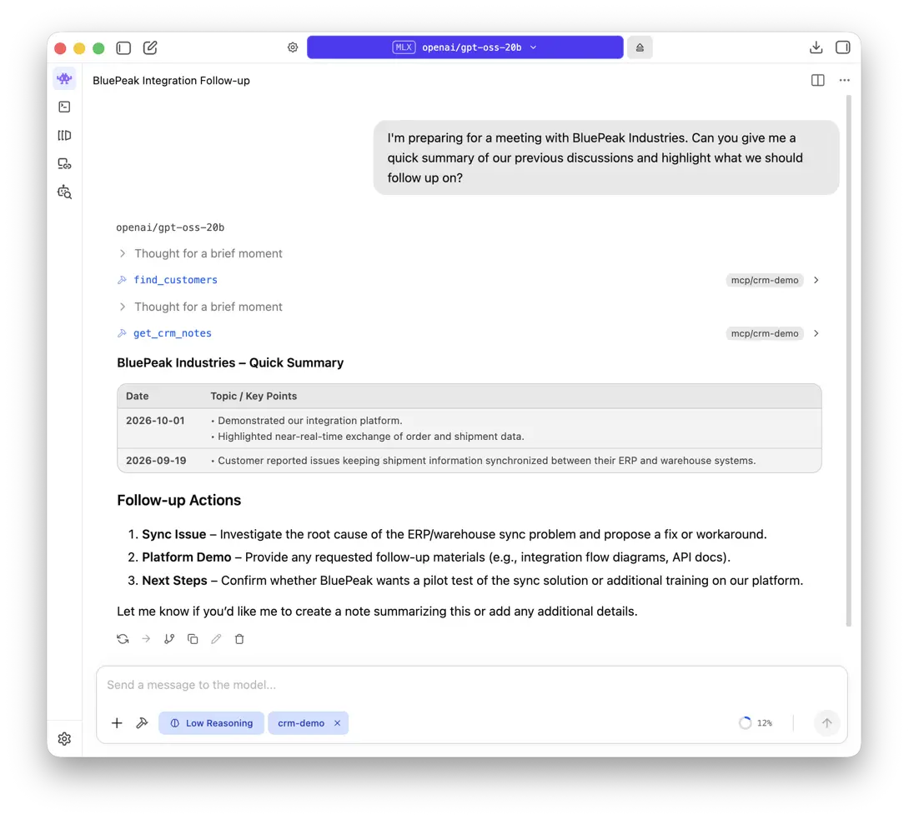
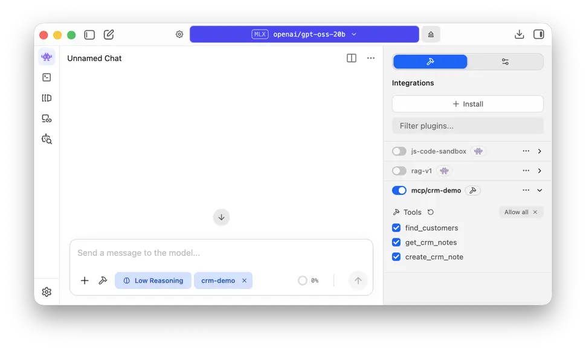
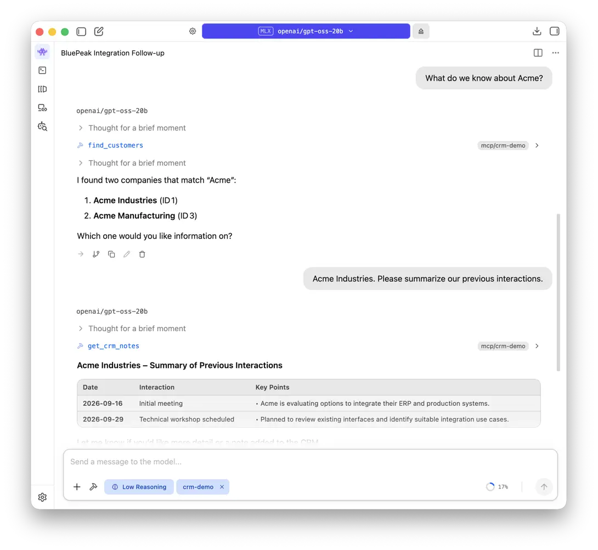
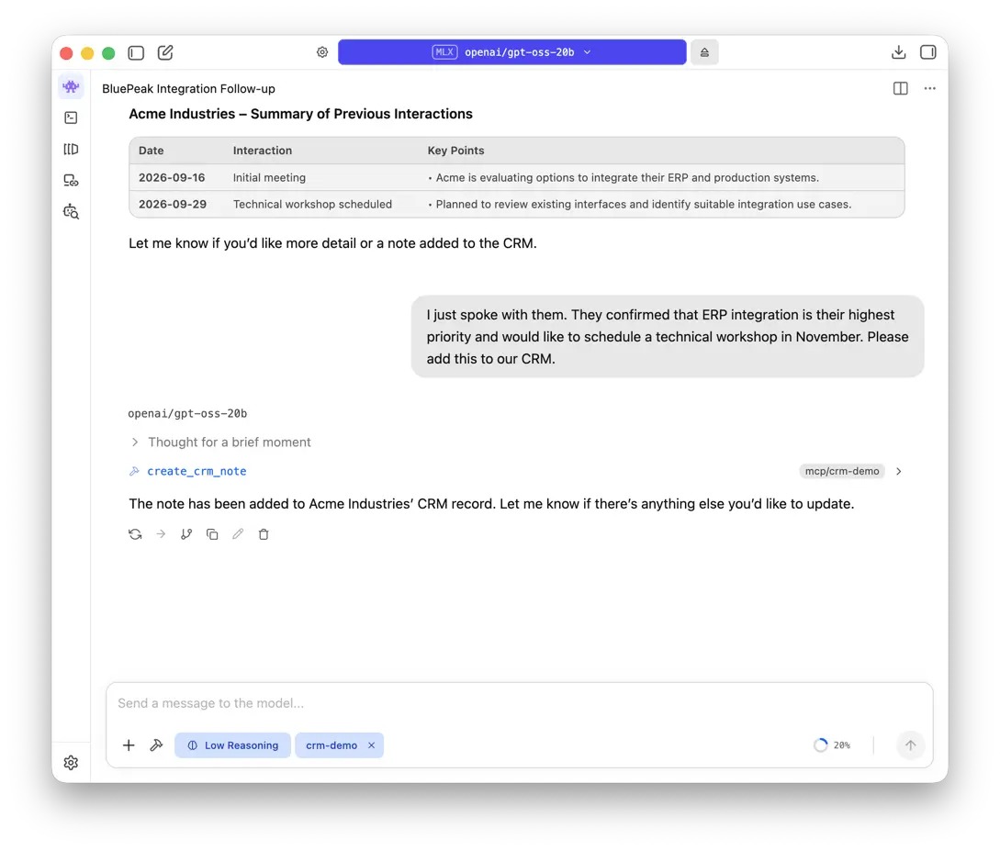
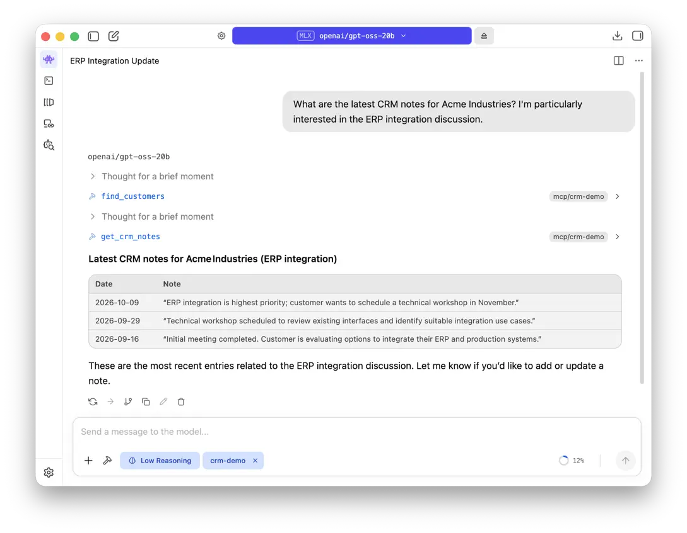

**What if your AI assistant could do more than answer questions—what if it could actually work with your business systems?**

Imagine asking an AI assistant to summarize previous customer interactions, highlight open topics, or record a meeting note directly in your CRM. No switching between applications, no copying data between screens, and no need to develop a separate AI application for each business operation.

With **Apache Camel and the Model Context Protocol (MCP)**, existing business capabilities can be exposed to AI assistants through lightweight integration routes. In our example, a locally running LLM retrieves customer information and writes new CRM notes through a natural-language conversation.

**The takeaway:** Connecting AI to business systems can be surprisingly straightforward. You can reuse established integration capabilities while retaining control over how business data is accessed.

## Introduction

Preparing for a customer meeting often means opening the CRM, finding the right account, reading through previous notes, and identifying open questions. After the meeting, someone must also record the next steps so they are not forgotten.

**What if you could do both by simply talking to an AI assistant?**

In our demo, we start with a natural question:

> I'm preparing for a meeting with BluePeak Industries. Can you give me a quick summary of our previous discussions and highlight what we should follow up on?

The local AI assistant searches the CRM, retrieves BluePeak's history, and produces a meeting briefing. It identifies the earlier ERP/warehouse synchronization issue and the subsequent integration-platform discussion, then suggests follow-up topics based on those records.



*The local LLM calls `find_customers` and `get_crm_notes` through Apache Camel to prepare a customer meeting summary.*

And it does not stop at reading. In the walkthrough below, we use a different customer—Acme Industries—to show how the same assistant can add a new CRM note and retrieve it again in a fresh conversation. The update happens **in the CRM**, not merely in the chat history.

Under the hood, a local LLM runs in [LM Studio][5], while [Apache Camel][1] exposes three CRM operations through the [Model Context Protocol (MCP)][2]. A small SQLite database represents the CRM.

There is no custom MCP server or REST API to implement. **The AI handles the conversation; Camel executes the business operations.**

Let's see how it works.

## What we are going to build

The CRM is deliberately simple. It contains customers and notes about previous meetings, technical discussions, and follow-up activities. We use SQLite so the example runs on one computer without an external database or CRM account.

The setup looks like this:

```text
You: "What do we know about Acme Industries?"
                       |
                       v
             LM Studio + local LLM
                       |
                 MCP tool calls
                       |
                       v
           http://localhost:12380/mcp
                       |
                       v
                Apache Camel
                 ai-tool routes
                       |
                  Camel SQL
                       |
                       v
                 SQLite CRM
                    crm.db
```

The model does **not** connect directly to SQLite. Instead, it receives a small, well-defined set of tools. Each tool has a name, a description, and typed arguments. When the model decides that a tool is needed, LM Studio invokes it through MCP, and Camel executes the corresponding route.

Our example exposes exactly three operations:

| MCP tool | What it does | Input |
| --- | --- | --- |
| `find_customers` | Searches customers by name | `query` |
| `get_crm_notes` | Retrieves the latest notes for a customer | `customer_id` |
| `create_crm_note` | Stores a new note for an existing customer | `customer_id`, `note` |

This separation is important. A model may request these three operations, but we are **not** giving it a generic tool to execute arbitrary SQL statements. Camel remains responsible for the queries and updates that the application allows.

The complete example consists of four files:

```text
camel-ai-mcp-crm-demo/
├── application.properties
├── init.camel.yaml
├── crm-mcp.camel.yaml
└── README.md
```

The example uses Camel's `ai-tool` component and built-in MCP server, introduced in **Apache Camel 4.22**. Both are available when running YAML routes directly with Camel CLI; no Java application project is necessary for this demo. ([Apache Camel – AI Tool][1], [Apache Camel – MCP Server][2])

## Get the complete example and run it

The complete runnable source is available in the [https://github.com/digitalchange-eu/camel-ai-mcp-crm-demo][7] repository on GitHub. Clone the repository and start the Camel application with three commands:

```shell
git clone https://github.com/digitalchange-eu/camel-ai-mcp-crm-demo.git
cd camel-ai-mcp-crm-demo
camel run init.camel.yaml crm-mcp.camel.yaml
```

You need **Git, Apache Camel CLI 4.22 or newer, and Java 17 or newer**. See the [Camel CLI documentation][4] if Camel is not installed yet. The example's `application.properties` supplies the SQLite JDBC dependency and MCP server configuration, so there is no separate database service to install.

After the database initialization message appears, the MCP server is available at `http://localhost:12380/mcp`. Later, in [Step 4](#step-4-connect-lm-studio-and-a-local-llm), we will point LM Studio at that address to let the local model use the tools.

If you prefer to understand the implementation before running it, the next sections walk through the same four files in detail.

## Why MCP changes the integration story

A language model does not automatically have access to company data or business applications. The Model Context Protocol (MCP) provides a standard interface through which AI applications can discover and invoke external capabilities, such as searching customers or creating CRM notes.

With Apache Camel 4.22, an `ai-tool:` consumer exposes a regular Camel route as an AI-callable tool. Camel's embedded MCP server handles tool registration, discovery, and communication over streamable HTTP. Developers can focus on integrating business systems instead of implementing the MCP protocol themselves. ([Apache Camel - MCP Server][2])

## Step 1: Create a small CRM

Before exposing anything to an AI assistant, we need a system with some data. `init.camel.yaml` sets up an SQLite `DataSource`, creates the `customers` and `crm_notes` tables, and inserts a few sample records.

The data source is configured directly in YAML (excerpt):

```yaml
- beans:
    - name: dataSource
      type: org.sqlite.SQLiteDataSource
      properties:
        url: "jdbc:sqlite:crm.db"
```

The two tables contain a customer ID, a unique name, and creation timestamps, as well as a collection of customer notes. The notes table references the customer table by `customer_id`.

Our initialization route uses familiar Camel SQL operations to create the schema and load the sample data. Among the customers are:

```text
Acme Industries
Acme Manufacturing
BluePeak Industries
```

That first pair is intentional. If a user says only *Acme*, the assistant should not assume which customer is meant. We want to demonstrate not only successful tool calls, but also how the model handles an ambiguous business reference before accessing or changing data.

The initialization route uses `CREATE TABLE IF NOT EXISTS` and `INSERT OR IGNORE`, so restarting the demo does not create duplicate seed records. We could just as well use an existing CRM API or a production database behind these tool routes; SQLite simply keeps the example self-contained.

## Step 2: Turn Camel routes into MCP tools

The main implementation lives in `crm-mcp.camel.yaml`. It defines the three tools as ordinary Camel routes, each starting from an `ai-tool:` consumer.

### Find a customer

The first route searches customers by name:

```yaml
- route:
    id: find-customers
    from:
      uri: ai-tool:find_customers
      parameters:
        tags: crm
        title: "Find customers"
        description: >
          Searches existing CRM customers by name.
          Use this tool when a customer is referenced by name and the
          corresponding CRM customer ID is not yet known.
        parameter.query: string
        parameter.query.description: >
          Customer name or partial customer name to search for.
        parameter.query.required: true
        readOnlyHint: true
      steps:
        - to:
            uri: >-
              sql:SELECT id, name
              FROM customers
              WHERE LOWER(name)
                LIKE LOWER('%' || CAST(:#query AS VARCHAR) || '%')
              ORDER BY name
              LIMIT 20
        - marshal:
            json: {}
```

There are several interesting details in this short route.

First, `ai-tool:find_customers` is the tool name the AI application sees. The `description` tells the model when to use the tool. The `parameter.query` options describe a required string argument, which Camel makes available to the route as the `query` message header. Tool descriptions and parameter metadata are therefore part of the integration contract, not just comments for developers. ([Apache Camel – AI Tool][1])

Second, the business operation is regular Camel SQL. The expression `:#query` binds the header value as a SQL parameter rather than concatenating user-supplied input into a SQL command. The SQL result is then marshalled to JSON and returned as the tool result. ([Apache Camel – SQL][3])

Finally, we limit the result to 20 matches. If the user asks for *Acme*, the response includes both **Acme Industries** and **Acme Manufacturing**. The model can use the returned identifiers internally, but should ask the user which company they mean before proceeding.

### Read CRM history

Once a customer has been identified, the second tool retrieves the most recent notes. This is an **excerpt from the route's `from` definition**, not a complete standalone YAML route:

```yaml
from:
  uri: ai-tool:get_crm_notes
  parameters:
    tags: crm
    description: >
      Returns the most recent CRM notes for an existing customer.
      Requires the internal CRM customer ID.
      If only a customer name is known, use find_customers first.
    parameter.customer_id: integer
    parameter.customer_id.required: true
    readOnlyHint: true
  steps:
    - log:
        message: "Loading CRM notes for customer ${header.customer_id}"
    - to:
        uri: >-
          sql:SELECT
            n.id, n.customer_id, c.name AS customer_name, n.note,
            strftime('%Y-%m-%dT%H:%M:%SZ', n.created_at) AS created_at
          FROM crm_notes n
          JOIN customers c
            ON c.id = n.customer_id
          WHERE n.customer_id = :#customer_id
          ORDER BY n.created_at DESC
          LIMIT 20
    - marshal:
        json: {}
```

The route executes a query joining `crm_notes` with `customers`, filters by `customer_id`, sorts by creation time, and returns the latest 20 notes as JSON.

Here the tool description does more than describe a database query. It explains the expected workflow: **resolve the customer first, then read their notes**. The model can discover that relationship without any hard-coded orchestration in LM Studio.

### Create a new CRM note

The third tool updates the CRM. It accepts a customer ID and a note, inserts the record, and returns a small confirmation payload.

The essential parts of the route look like this:

```yaml
- route:
    id: create-crm-note
    from:
      uri: ai-tool:create_crm_note
      parameters:
        tags: crm
        description: >
          Stores a new CRM note for an existing customer.
          If only a customer name is known, use find_customers first.
        parameter.customer_id: integer
        parameter.customer_id.required: true
        parameter.note: string
        parameter.note.required: true
        readOnlyHint: false
        idempotentHint: false
      steps:
        - to:
            uri: >-
              sql:INSERT INTO crm_notes
              (customer_id, note)
              VALUES (:#customer_id, :#note)
        - setBody:
            simple: |
              {
                "success": true,
                "customer_id": ${header.customer_id}
              }
```

The database generates the note ID and creation timestamp. The model provides the content, but it does not construct the SQL statement or choose which table to modify.

Notice the metadata: `readOnlyHint` is `false`, and `idempotentHint` is `false`. A second identical call would create another note. These MCP annotations help clients present the operation appropriately, but they are **advisory hints, not authorization rules**. Protecting real CRM data requires enforcement on the server side. ([Apache Camel – AI Tool][1])

And that is the entire idea: three small routes, each implementing one purposeful business capability. We do not need a separate tool controller or hand-written MCP protocol code.

## Step 3: Let Camel serve the tools over MCP

The tool routes are ready, but an external AI application still needs a way to discover them. Camel's embedded MCP server handles that with a few configuration properties.

In `application.properties` we enable the server and select the `crm` tool group:

```properties
# SQLite JDBC driver used by the example
camel.jbang.dependencies=org.xerial:sqlite-jdbc:3.50.3.0

# Camel's embedded MCP server
camel.server.enabled=true
camel.server.port=12380
camel.server.mcp-enabled=true
camel.server.mcp-tags=crm
camel.server.mcp-server-name=crm-demo
```

All three routes use `tags: crm`. The `camel.server.mcp-tags=crm` property tells Camel which registered tools to expose. Other tools would not automatically become available just because they exist in the same application. This is an explicit publication decision, which is useful when different applications need access to different capabilities. ([Apache Camel – MCP Server][2])

If you followed the [quick start](#get-the-complete-example-and-run-it), Camel is already running. The command `camel run init.camel.yaml crm-mcp.camel.yaml` loads both YAML files and the adjacent `application.properties`. The initialization route prepares the local database; after its completion message, the CRM tools can be called through:

```text
http://localhost:12380/mcp
```

This is an **MCP endpoint**, not a normal REST endpoint for browsing in a web page. Camel uses MCP's streamable HTTP transport to support tool discovery and invocation. ([Apache Camel – MCP Server][2], [Apache Camel CLI][4])

At this point, we have an MCP server backed by three working business routes—without adding a separate MCP server implementation.

## Step 4: Connect LM Studio and a local LLM

Now for the visible part of the demo. [LM Studio][5] lets us run an LLM locally and connect MCP servers to its chat interface. This gives us a useful setup for a business integration demonstration: the model, Camel application, and sample CRM can all run on the same computer.

In LM Studio, load a model that supports tool/function calling. For this demo, we use **`openai/gpt-oss-20b`**, which supports tool calling and can run locally. Other tool-capable models may work as well; this is a practical starting point, not a claim that one model always works best. ([LM Studio - Run gpt-oss locally][8])

The model choice matters: some models handle ordinary text well but struggle to select the correct tools, supply typed arguments, or recover from ambiguity. When trying a different model, verify that it actually calls `find_customers`, `get_crm_notes`, and `create_crm_note` rather than merely describing what it would do.

In LM Studio, open the **Integrations** (the hammer symbol) area in the right-hand sidebar, choose **Install → Edit mcp.json**, and add a server entry:

```json
{
  "mcpServers": {
    "crm-demo": {
      "url": "http://localhost:12380/mcp"
    }
  }
}
```

Save the configuration and make the CRM server available to the conversation. LM Studio should discover these tools:

```text
find_customers
get_crm_notes
create_crm_note
```

The JSON configuration above assumes LM Studio and Camel run on the same computer. For a different host, the URL and the surrounding network security must be adjusted.



*LM Studio discovers all three Camel MCP tools. They can now be enabled for the local model's conversations.*

### Give the assistant a small amount of guidance

MCP exposes the tools, but the model still decides when to use them. A concise system prompt helps it follow sensible CRM behavior:

```text
You are a CRM assistant. Use the available CRM tools to retrieve
information or save notes requested by the user.

Always identify the relevant company before reading or writing data.
If a customer search returns multiple companies, ask which one is meant.
Never invent a customer ID or CRM information.
Only create a note when the user explicitly asks you to save it.
If a tool call fails, do not claim that the operation succeeded.
Keep the response concise and hide internal CRM IDs unless needed.
```

The example's `README.md` contains a longer version of these instructions. Each instruction addresses a practical issue:

- **Identify the company first:** Customer names are not reliable database identifiers. For *Acme*, the search returns two plausible matches, so the assistant must ask before reading or writing.
- **Never invent CRM data or IDs:** The model must base its answer and subsequent tool calls on actual tool results, not on plausible guesses.
- **Write only when requested:** A summary request should not silently become a database update.
- **Do not claim success after a failed tool call:** If the database is unavailable or the insert fails, the assistant must not turn its own intention to create a note into a statement that the note was saved. A successful write needs confirmation from the tool result.

These instructions guide the assistant, but they are not a security boundary: Camel and the backing business systems still need to validate requests and enforce authorization. They also do not guarantee perfect model behavior, which is why the final verification step matters.

## The demo: from natural language to real CRM operations

With Camel running and the CRM tools enabled in LM Studio, we can stop thinking about route definitions for a moment and simply talk to the application.

The screenshots below show an actual conversation using **`openai/gpt-oss-20b`** in LM Studio. The exact wording of the model's responses may differ with another model, but the important part is the customer data read and written through Camel's tools.

### 1. Ask about a customer

Start with a deliberately ambiguous request:

> What do we know about Acme?

The assistant has a tool specifically designed for this situation. It can invoke:

```text
find_customers(query="Acme")
```

Our test data contains two matches: **Acme Industries (ID 1)** and **Acme Manufacturing (ID 3)**. The screenshot shows these internal IDs, which are useful for subsequent tool calls, but they do not resolve which company the person meant. Rather than guessing, the assistant asks for clarification.

> I found Acme Industries and Acme Manufacturing. Which company do you mean?

This step might not look impressive at first, but it matters. In business processes, selecting the wrong customer can be worse than returning no answer at all.

### 2. Retrieve and summarize the history

Reply:

> Acme Industries. Please summarize our previous interactions.

The assistant can use the resolved customer ID and call `get_crm_notes`. The sample data includes an initial discussion about integrating ERP and production systems, followed by a technical workshop to review interfaces and identify suitable use cases.

Instead of showing raw database rows, the model can summarize those interactions in a readable answer. The facts come from the CRM; the model's role is to make them easier to consume.



*The assistant asks for clarification rather than guessing, then retrieves the selected customer's history via `get_crm_notes`.*

### 3. Write a new note in natural language

Now we move from reading data to changing it:

> I just spoke with them. They confirmed that ERP integration is their highest priority and would like to schedule a technical workshop in November. Please add this to our CRM.

Because the conversation has already established that *them* means **Acme Industries**, the assistant can call `create_crm_note` using the previously resolved customer ID. Camel executes the parameterized `INSERT` statement against SQLite and returns a success response. The user did not have to repeat the account name or specify a database ID.

The application has performed a genuine write operation—not generated a plausible-looking confirmation based on its language model alone. The note is stored in the database.



*The assistant calls `create_crm_note` and confirms that the conversation's new information was saved to the selected CRM customer.*

### 4. Verify the result

Finally, **start a new chat in LM Studio**, keeping the same MCP server enabled, and ask:

> What are the latest CRM notes for Acme Industries? I'm particularly interested in the ERP integration discussion.

The assistant resolves the customer again, calls `get_crm_notes`, and retrieves the note about **ERP integration being the highest priority and the requested technical workshop in November** alongside the earlier customer interactions. The verification screenshot shows a separate conversation, so the new information cannot be explained by the model merely remembering the previous chat. **The note was persisted in SQLite and retrieved again through Camel.**



*Verification from a new chat: `find_customers` and `get_crm_notes` return the newly saved note from the CRM.*

The model can choose the next tool based on the conversation, while Camel controls which business operations are available. **Flexibility in the user interaction, explicit boundaries in the integration.**

## When something goes wrong

The happy path makes a good demo, but real integrations also need to fail predictably. Two simple examples illustrate why.

If SQLite is temporarily locked during an insert, the SQL operation may fail. If a required tool argument such as `customer_id` is omitted, the request may fail validation before the intended SQL operation can run. In neither case should the assistant tell the user that a new note was saved.

Camel's MCP server includes tool-call validation and error sanitization. Its documentation describes generic errors for route execution failures rather than disclosing raw internal exception details to the MCP client. Standard Camel error-handling constructs such as `onException` can be used within the integration to classify failures, log diagnostic details on the server, and define application-specific responses. **The exact behavior visible in LM Studio depends on the failure and how the route handles it**; do not assume that a generic failure automatically becomes a user-friendly message or that retrying a write is always safe. ([Apache Camel – MCP Server][2], [Apache Camel – AI Tool][1])

For an actual CRM integration, a useful policy is to return a clear, intentionally designed outcome such as *could not save the note; please retry later*, without exposing SQL statements or connection details. Retrying a non-idempotent write operation should be controlled carefully to avoid duplicate notes. A client timeout does not, by itself, prove that a write was never completed. This demo keeps the routes short, but the same Camel error-handling patterns can be added when moving beyond the example.

## Beyond the mock CRM

Consider an existing Camel route that can look up orders in an ERP system, retrieve shipment tracking information, or create a support ticket. Such operations could be exposed through `ai-tool:` routes with purposeful names and arguments, while the implementation continues using Camel's existing integration components and patterns.

For example, an ERP tool might begin with the following route skeleton:

```yaml
- route:
    id: check-order-status
    from:
      uri: ai-tool:check_order_status
      parameters:
        tags: erp
        description: "Look up the status of an existing ERP order."
        parameter.order_id: string
        parameter.order_id.required: true
      steps:
        - to: "direct:erp-order-status"
```

`direct:erp-order-status` represents an **existing integration route** that would validate the order ID, call the actual ERP system, and return a useful result. This example uses a separate `erp` tag; exposing it would require including that tag in the MCP server's publication configuration. It is deliberately not part of the runnable SQLite demo. The key point is that the AI-facing tool can remain tiny while Camel handles the enterprise-specific integration behind it.

A conversational assistant could then answer questions such as:

- *What is the current status of customer order 4711?*
- *Which shipments for this customer are delayed?*
- *Create a support ticket for the issue we just discussed.*

The model does not need to understand the ERP protocol or the details of a message broker. Camel handles connectivity, message transformations, routing, and business operations. MCP provides a standard interface through which the AI application can access the capabilities that have been intentionally published.

This also means the setup is not tied to LM Studio. We use LM Studio because a locally running model makes the demo accessible and self-contained. Other MCP-capable clients can use the same tools without rewriting the Camel routes. ([Apache Camel – MCP Server][2])

### A word about security

A local demo is a good way to understand the integration, but **local execution does not automatically make access safe**. The MCP endpoint performs real reads and writes. For production use, authentication and authorization must be enforced at the integration boundary, and permissions should be scoped to the caller and the operation. Tool annotations and a system prompt do not establish those permissions.

The demo deliberately exposes only a small set of named CRM operations, rather than unrestricted database access. Queries use bound parameters, but a real deployment also needs network and transport security, input validation, auditing, clear policies for write operations, and careful handling of sensitive data. Where an action has business consequences, consider requiring explicit user confirmation or an approval step. Camel's MCP server integrates with the runtime's HTTP security mechanisms; authorization decisions must be enforced in the route or an appropriately protected service layer. ([Apache Camel – MCP Server][2], [Authorizing AI Tools in Camel][6])

If a locally running LLM is used with a local CRM and an appropriately restricted MCP endpoint, there is no requirement to send those CRM records to a cloud-hosted language model. That is an architectural choice, not an automatic guarantee: other integrations, enabled tools, or deployment choices can still move information elsewhere.

## Conclusion

With just three Camel YAML routes, we have enabled a locally running LLM to find customers, retrieve interaction history, and store new CRM notes using natural language. No custom MCP server or AI-specific application code was required.

**The real value is not that an LLM can generate a CRM note. It is that an LLM can use an existing integration to read and update the CRM while the business logic stays where it belongs.**

This approach provides a practical starting point for making existing enterprise systems accessible to AI assistants, without rebuilding those systems for AI.

**Want to try it?** The [complete runnable example][7] is available on GitHub.

[1]: /components/next/ai-tool-component.html "Apache Camel – AI Tool Component"
[2]: /components/next/others/mcp-server.html "Apache Camel – MCP Server"
[3]: /components/next/sql-component.html "Apache Camel – SQL Component"
[4]: /manual/camel-jbang-running.html "Apache Camel – Running Camel CLI"
[5]: https://lmstudio.ai/docs/app/mcp "LM Studio – Use MCP Servers"
[6]: /blog/2026/09/securing-ai-agent-tools/ "Apache Camel – Authorizing what an AI agent may do"
[7]: https://github.com/digitalchange-eu/camel-ai-mcp-crm-demo "Complete Camel AI/MCP CRM example"
[8]: https://lmstudio.ai/blog/gpt-oss "LM Studio – Run gpt-oss locally"
