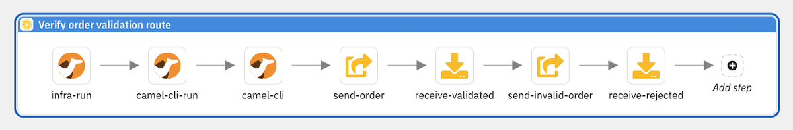
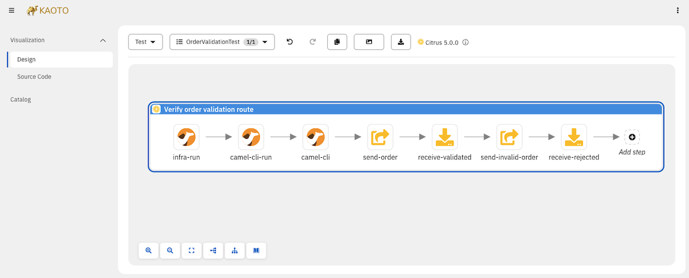
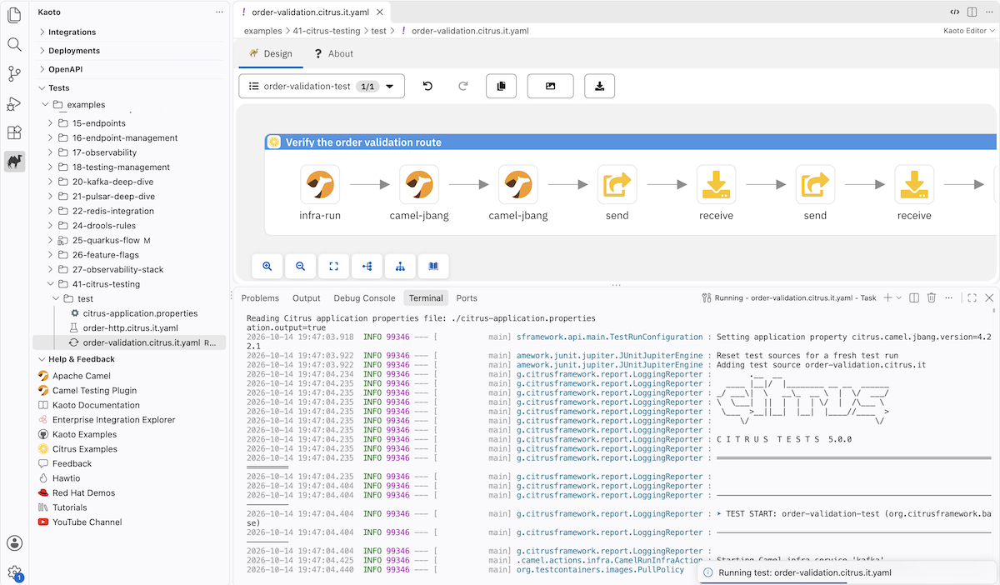

Camel's YAML DSL lets you define integration routes without writing Java.
[Camel JBang](/manual/camel-jbang.html) lets you run them without a build tool.
But how do you test them?
Writing a Java test class with JUnit, `@QuarkusTest`, and Maven feels like overkill when the route itself is a single 20-line YAML file.

[Citrus](https://citrusframework.org) is an open-source integration testing framework that works natively with Apache Camel.
It supports a YAML test DSL that mirrors the same declarative approach: you define your tests in `*.citrus.it.yaml` files alongside your YAML routes and run them with `camel test`.
No Java, no Maven, no build configuration.
Infrastructure starts automatically, messages flow through real Kafka topics, and validations run against actual output — all in YAML.

This post walks through YAML DSL testing with a Kafka example: route validation, infrastructure lifecycle, launching integrations, and verifying results.

## The Camel CLI test plugin

The Camel CLI ships a test plugin that integrates Citrus directly into the `camel` command.
Install it once:

```bash
camel plugin add test
```

After that, the following commands are available:

| Command                      | Description                           |
|------------------------------|---------------------------------------|
| `camel test init <name>`     | Scaffold a new Citrus test file       |
| `camel test run <file>`      | Run a test                            |
| `camel test inspect <file>`  | Inspect a test file's structure       |
| `camel test ps`              | List running tests                    |

No Maven, no Gradle, no build configuration — the plugin resolves Citrus dependencies on the fly via JBang.

## Initialize a Citrus test

The best way to get started with a new Citrus test is to use the `init` command:

```bash
camel test init order-validation.citrus.it.yaml
```

This creates a test file with the basic structure — name, description, and an empty `actions` list — ready for you to fill in.

The recommended project layout keeps test files in a dedicated `test/` directory alongside the route files:

```
├── order-validation-route.camel.yaml   # Camel route
├── application.properties              # Route configuration
└── test/
    ├── order-validation.citrus.it.yaml  # Citrus test
    ├── citrus-application.properties    # Test settings
    └── templates/
        └── order.json                   # Message templates
```

The test plugin handles this directory structure automatically.
When you run `camel test init`, it creates the file inside `test/` by default.
When you run `camel test run`, specify the path including the `test/` directory:

```bash
camel test run test/order-validation.citrus.it.yaml
```

The file name uses the naming convention `<name>.citrus.it.yaml` — the `*.citrus.it.yaml` suffix tells the Camel test runner to treat it as a Citrus integration test.

## The YAML test file structure

A Citrus YAML test file has four parts: a name, a description, optional variables, and a list of actions that execute sequentially:

_order-validation.citrus.it.yaml_
```yaml
name: order-validation-test
description: "Verify order validation route correctly routes valid and invalid orders"
actions:
  - send:
      endpoint: "kafka:eip.orders.incoming"
      message:
        body:
          data: |
            {"orderId":"ORD-001","customerId":"C-101","item":"Shipping Container","quantity":2}
  - receive:
      endpoint: "kafka:eip.orders.validated?consumerGroup=citrus-validated"
      timeout: 20000
      message:
        body:
          data: |
            {"orderId":"ORD-001","customerId":"C-101","item":"Shipping Container","quantity":2,"status":"validated"}
```

The received message includes a `"status":"validated"` field that the route added during processing — the test verifies that the route actually did something, not just that the message passed through unchanged.

Actions run top to bottom: each action must complete before the next one starts.
If any action fails, the test stops immediately with a validation error.

You run the test with the Camel CLI:

```bash
camel test run test/order-validation.citrus.it.yaml
```

No `pom.xml`, no `mvn verify`, no JUnit runner.
The Camel test plugin handles dependency resolution, Citrus initialization, and test execution.

## An example — Testing Kafka routes

### The Camel route under test

Here is an order validation route written in YAML DSL.
It consumes orders from Kafka, checks for required fields, and routes valid orders to `eip.orders.validated` and invalid ones to `eip.orders.rejected`:

```yaml
- route:
    id: order-validation
    from:
      uri: kafka:eip.orders.incoming
      steps:
        - unmarshal:
            json:
              unmarshalType: java.util.Map
        - choice:
            when:
              - simple: "${body[orderId]} == null"
                steps:
                  - log:
                      message: "REJECTED — missing orderId: ${body}"
                      loggingLevel: WARN
                  - setBody:
                      groovy: "body + [status: 'rejected', reason: 'orderId must not be null']"
                  - marshal:
                      json: {}
                  - to:
                      uri: kafka:eip.orders.rejected
              - simple: "${body[customerId]} == null"
                steps:
                  - log:
                      message: "REJECTED — missing customerId for order ${body[orderId]}"
                      loggingLevel: WARN
                  - setBody:
                      groovy: "body + [status: 'rejected', reason: 'customerId must not be null']"
                  - marshal:
                      json: {}
                  - to:
                      uri: kafka:eip.orders.rejected
              - simple: "${body[item]} == null"
                steps:
                  - log:
                      message: "REJECTED — missing item for order ${body[orderId]}"
                      loggingLevel: WARN
                  - setBody:
                      groovy: "body + [status: 'rejected', reason: 'item must not be null']"
                  - marshal:
                      json: {}
                  - to:
                      uri: kafka:eip.orders.rejected
              - simple: "${body[quantity]} == null || ${body[quantity]} <= 0"
                steps:
                  - log:
                      message: "REJECTED — invalid quantity for order ${body[orderId]}"
                      loggingLevel: WARN
                  - setBody:
                      groovy: "body + [status: 'rejected', reason: 'quantity must be greater than zero']"
                  - marshal:
                      json: {}
                  - to:
                      uri: kafka:eip.orders.rejected
            otherwise:
              steps:
                - log:
                    message: "VALIDATED — order ${body[orderId]} for customer ${body[customerId]}"
                - setBody:
                    groovy: "body + [status: 'validated']"
                - marshal:
                    json: {}
                - to:
                    uri: kafka:eip.orders.validated
```

Each branch enriches the body map with a `status` field (and a `reason` for rejections) before marshalling back to JSON.
The Groovy expression `body + [status: 'validated']` creates a new map containing all original fields plus the added entries.
The `log` statements come before `setBody` — they access the original map fields with `${body[orderId]}`, which works because the body is still a `Map` at that point.

The route has five branches: four rejection cases (missing `orderId`, `customerId`, `item`, or zero/missing `quantity`) and one success path.
The test below covers four of them — enough to verify the routing logic end to end.

With Camel JBang you can run this single file with no further project setup — perfect for fast prototyping and experimenting:

```bash
camel run order-validation-route.camel.yaml
```

### The Citrus YAML test

The Citrus YAML test mirrors this approach — fast prototyping and declarative testing without any further project setup.
It uses the full capabilities of the Citrus framework with test actions and validation steps, expressed entirely in YAML:

```yaml
name: order-validation-test
description: "Verify order validation route correctly routes valid and invalid orders"
actions:
  # --- Scenario 1: valid order ---
  - send:
      endpoint: "kafka:eip.orders.incoming"
      message:
        body:
          data: |
            {"orderId":"ORD-001","customerId":"C-101","item":"Shipping Container","quantity":2}
  - receive:
      endpoint: "kafka:eip.orders.validated?consumerGroup=citrus-validated"
      timeout: 20000
      message:
        body:
          data: |
            {"orderId":"ORD-001","customerId":"C-101","item":"Shipping Container","quantity":2,"status":"validated"}

  # --- Scenario 2: missing customerId ---
  - send:
      endpoint: "kafka:eip.orders.incoming"
      message:
        body:
          data: |
            {"orderId":"ORD-002","item":"Pallet Jack","quantity":1}
  - receive:
      endpoint: "kafka:eip.orders.rejected?consumerGroup=citrus-rejected"
      timeout: 20000
      message:
        body:
          data: |
            {"orderId":"ORD-002","item":"Pallet Jack","quantity":1,"status":"rejected","reason":"customerId must not be null"}

  # --- Scenario 3: zero quantity ---
  - send:
      endpoint: "kafka:eip.orders.incoming"
      message:
        body:
          data: |
            {"orderId":"ORD-003","customerId":"C-102","item":"Cargo Net","quantity":0}
  - receive:
      endpoint: "kafka:eip.orders.rejected?consumerGroup=citrus-rejected"
      timeout: 20000
      message:
        body:
          data: |
            {"orderId":"ORD-003","customerId":"C-102","item":"Cargo Net","quantity":0,"status":"rejected","reason":"quantity must be greater than zero"}

  # --- Scenario 4: missing item ---
  - send:
      endpoint: "kafka:eip.orders.incoming"
      message:
        body:
          data: |
            {"orderId":"ORD-004","customerId":"C-103","quantity":5}
  - receive:
      endpoint: "kafka:eip.orders.rejected?consumerGroup=citrus-rejected"
      timeout: 20000
      message:
        body:
          data: |
            {"orderId":"ORD-004","customerId":"C-103","quantity":5,"status":"rejected","reason":"item must not be null"}
```

Each scenario follows the same pattern: `send` a message to the input topic, `receive` from the expected output topic.
The `consumerGroup` parameter ensures Citrus uses a dedicated consumer group that does not interfere with the route's own consumers.
The `timeout: 20000` gives the route up to 20 seconds to process the message — if no message arrives on the expected topic within that window, the test fails.

The body validation is an exact JSON match.
Citrus parses both the expected and actual JSON, compares every field, and reports any mismatch.
If the route changed a field value or dropped a field during processing, the validation catches it.

## Starting test infrastructure

The route under test connects to a Kafka message broker.
You need to prepare this test infrastructure locally before starting the Camel route and the test.
Even more conveniently, you can let the Citrus test handle the infrastructure provisioning.

When the test needs real infrastructure — a Kafka broker, a database, a Pulsar cluster — you start it with the `camel.infra.run` action:

```yaml
actions:
  - camel:
      infra:
        run:
          service: "kafka"
          fixedPort: true
```

The `camel.infra.run` action leverages the Camel CLI infrastructure management to start a local service instance.
Here `service: "kafka"` starts a Kafka broker using the preconfigured Testcontainers image — no Docker Compose file needed.
The `fixedPort: true` option ensures the broker binds to its well-known port (9092), so the route's default `kafka:` endpoint URIs work without any additional configuration.

This approach keeps the test file self-contained: a single action replaces the Docker Compose file, health-check polling, and port configuration that you would otherwise manage separately.

## Launching Camel route integrations

When you build a full Quarkus or Spring Boot project, the framework automatically starts the application under test.
When prototyping with the YAML DSL, the Citrus test takes care of launching the Camel route explicitly using the Camel CLI:

```yaml
  - camel:
      cli:
        run:
          integration:
            name: "order-validation"
            file: "../order-validation-route.camel.yaml"
```

The `camel.cli.run` action starts a Camel JBang integration as a subprocess managed by Citrus.
The `name` identifies the integration for later verification.
The `file` points to the YAML route definition relative to the test file.

> **Note:** Older Citrus versions use `camel.jbang` instead of `camel.cli` as the action name. Both are supported in Citrus 5.0.1+, but `camel.cli` is the preferred form going forward.

Because `camel.infra.run` started Kafka on its well-known port, the route's default `kafka:` endpoint URIs connect without any additional properties file.

Putting it all together — infrastructure, route launch, and test scenarios — the complete test file looks like this:

```yaml
name: order-validation-test
description: "Verify order validation route correctly routes valid and invalid orders"
actions:
  # --- Start infrastructure ---
  - camel:
      infra:
        run:
          service: "kafka"
          fixedPort: true

  # --- Launch the Camel route ---
  - camel:
      cli:
        run:
          integration:
            name: "order-validation"
            file: "../order-validation-route.camel.yaml"
  - camel:
      cli:
        verify:
          integration: "order-validation"
          logMessage: "Routes startup"

  # --- Scenario 1: valid order ---
  - send:
      endpoint: "kafka:eip.orders.incoming"
      message:
        body:
          data: |
            {"orderId":"ORD-001","customerId":"C-101","item":"Shipping Container","quantity":2}
  - receive:
      endpoint: "kafka:eip.orders.validated?consumerGroup=citrus-validated"
      timeout: 20000
      message:
        body:
          data: |
            {"orderId":"ORD-001","customerId":"C-101","item":"Shipping Container","quantity":2,"status":"validated"}

  # --- Scenario 2: missing customerId ---
  - send:
      endpoint: "kafka:eip.orders.incoming"
      message:
        body:
          data: |
            {"orderId":"ORD-002","item":"Pallet Jack","quantity":1}
  - receive:
      endpoint: "kafka:eip.orders.rejected?consumerGroup=citrus-rejected"
      timeout: 20000
      message:
        body:
          data: |
            {"orderId":"ORD-002","item":"Pallet Jack","quantity":1,"status":"rejected","reason":"customerId must not be null"}
```

The test starts Kafka via `camel.infra.run`, launches the Camel route, verifies it started successfully, and then runs through the test scenarios — all in a single self-contained YAML file.

## Verifying Camel integration logs

An advantage of starting the Camel integration as part of the test is that you can access the log output of the subprocess.
You can verify that the route processed message data correctly by checking its log output:

```yaml
  - camel:
      cli:
        verify:
          integration: "order-validation"
          logMessage: "VALIDATED — order ORD-001"
```

The `camel.cli.verify` action scans the integration's log for the specified message.
If the route logged `VALIDATED — order ORD-001` during processing, the verification passes.
This is a quick way to confirm the route received and processed a message without needing a separate `receive` action on the output topic.

To see the full integration output during test runs, add this setting to `citrus-application.properties` in your test directory:

```properties
citrus.camel.jbang.dump.integration.output=true
```

This is also a great way to inspect the Camel integration log output after the test for debugging and failure analysis.

## How YAML tests relate to Java-based testing

If you already write Camel integration tests with Quarkus or Spring Boot, the YAML DSL approach might seem unfamiliar.
But the underlying testing engine is the same Citrus framework.
The YAML DSL is a frontend that maps to the same action classes as the Java API.

Every Citrus integration test for Camel — regardless of runtime — follows the same pattern:

1. Start infrastructure and wait for it to be ready.
2. Wait for the Camel route to start.
3. Send a message to the route's input endpoint.
4. Receive and verify the message on the route's output endpoint.

In a Quarkus or Spring Boot project, you express this in Java with `send()`, `receive()`, and `repeatOnError()` actions, plus annotations like `@QuarkusTest` or `@SpringBootTest` for framework integration.
In the YAML DSL, you write `send:`, `receive:`, and `camel.cli.run:` actions in a `.citrus.it.yaml` file — same concepts, different syntax.

Here is a quick comparison of what changes across runtimes:

| Aspect         | Quarkus / Spring Boot            | YAML DSL                   |
|----------------|----------------------------------|----------------------------|
| Test language  | Java                             | YAML                       |
| Build tool     | Maven                            | None (Camel JBang)         |
| Test runner    | JUnit 5                          | `camel test` CLI           |
| Infrastructure | `BeforeSuite` / `AfterSuite`     | `camel.infra.run` action   |
| Route startup  | Automatic (framework manages it) | `camel.cli.run` action     |
| Verification   | Kafka receive + route stats      | Kafka receive + log verify |
| Dependencies   | `pom.xml`                        | Automatic (via JBang)      |

You can start with YAML tests for a JBang prototype and migrate to Java tests when the project grows into a Quarkus or Spring Boot application — the testing patterns transfer directly.

Your YAML DSL tests are not lost when you move to a Java project.
When the `camel test` plugin is active, the `camel export` command includes your `*.citrus.it.yaml` tests in the exported Spring Boot or Quarkus project as automated tests — no manual migration needed.

Citrus supports both YAML and Java DSL tests on top of JUnit Jupiter, with dedicated integration for Spring Boot (`@SpringBootTest`) and Quarkus (`@QuarkusTest`).
This means you can continue to use the same Citrus concepts — actions, endpoints, validation — when moving from a YAML DSL prototype to a full Java project.

## When to use YAML tests

YAML DSL tests are a natural fit for:

- **Camel CLI projects** — the route is YAML, the test is YAML, no build tool required.
- **Quick prototyping** — validate a route idea in minutes without setting up a Maven project.
- **Teams without Java expertise** — operations or DevOps teams maintaining integration routes.
- **Simple send/receive/validate flows** — the declarative syntax handles the most common test patterns cleanly.

Java tests are the better choice when you need:

- **Complex assertion logic** — custom predicates, programmatic validation, computed expected values.
- **Shared test utilities** — base classes with reusable helper methods.
- **Camel context access** — ControlBus commands, MBean route statistics, Camel mock endpoints.

Both approaches use the same Citrus engine underneath.

## Designing tests visually with Kaoto

Writing YAML by hand works well for simple tests, but as test files grow — multiple scenarios, infrastructure setup, database interactions, nested validation — a graphical view can make the structure easier to understand and edit.


[Kaoto](https://kaoto.io) is a visual designer for Apache Camel integrations.
It renders YAML DSL definitions as interactive flow diagrams where you can add, configure, and reorder steps by clicking instead of typing.
Kaoto has added the Citrus YAML DSL schemas to its catalog, so the visual designer handles Citrus YAML test files too — with full support for all test actions, action containers, functions, and validation matchers.



In Kaoto, a Citrus YAML test renders as a sequence of actions — `send`, `receive`, `camel`, `http`, `sql`, `testcontainers` — each represented as a configurable node.
You can:

- **Add test actions** from a palette — drag a `send` or `receive` action into the flow and configure endpoint URIs, message bodies, and headers through form fields instead of editing raw YAML.
- **Reorder actions** by moving action nodes up or down in the flow.
- **Configure validation** — set expected HTTP status codes, JSON response bodies, SQL column assertions, and timeout values through the action's property panel.
- **See the full test structure at a glance** — the flow diagram shows the complete test lifecycle from infrastructure startup through message exchange to final assertions.

This is especially useful for teams that are new to integration testing or prefer visual tooling.
The graphical editor produces the same `*.citrus.it.yaml` files shown throughout this post — you can switch between the visual editor and the YAML source at any time.
There is no lock-in: the file on disk is always standard Citrus YAML DSL.

### Kaoto Online

The [Kaoto online editor](https://kaotoio.github.io/kaoto/#/) runs directly in your browser — no installation required.
Open a `.citrus.it.yaml` file and the visual designer renders the test as an interactive flow.
You can create new Citrus tests, adjust existing ones, add or reconfigure test actions, and export the result — all without leaving the browser.



This is a great way to explore the Citrus YAML DSL and experiment with test structures before committing to a local setup.

### Kaoto VS Code extension

For a fully integrated experience, install the [Kaoto VS Code extension](https://marketplace.visualstudio.com/items?itemName=redhat.vscode-kaoto).
When you open a `.citrus.it.yaml` file in VS Code, the visual designer loads automatically alongside the YAML source.
You can edit Citrus tests visually — adding actions, configuring endpoints and message bodies, setting up infrastructure — and see the YAML update in real time.



The VS Code extension goes beyond editing: it integrates with the Camel CLI, so you can run your Citrus tests directly from the editor.
Right-click a test file and run it with `camel test` — the test output appears in the VS Code terminal, giving you a complete write-edit-run cycle without leaving the IDE.

## Where to find the examples

The complete source code for all tests shown in this post is available in the [Citrus Camel EIP examples](https://github.com/citrusframework/citrus-camel-eip-examples/tree/main) repository:

- **Order validation example**: [order-validation.citrus.it.yaml](https://github.com/citrusframework/citrus-camel-eip-examples/blob/main/examples/41-citrus-testing/test/order-validation.citrus.it.yaml) and the [route under test](https://github.com/citrusframework/citrus-camel-eip-examples/blob/main/examples/41-citrus-testing/order-validation-route.camel.yaml).

The repository contains many more Camel EIP examples with Citrus tests — covering different messaging patterns, protocols, and runtimes.

Install the Camel test plugin with `camel plugin add test`, then run any test with `camel test run <file>`.
Give it a try, and let us know what you think!
