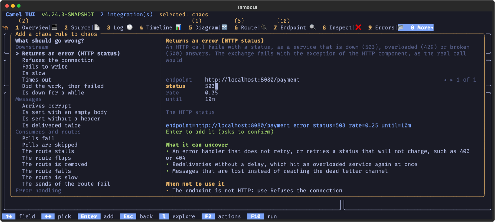
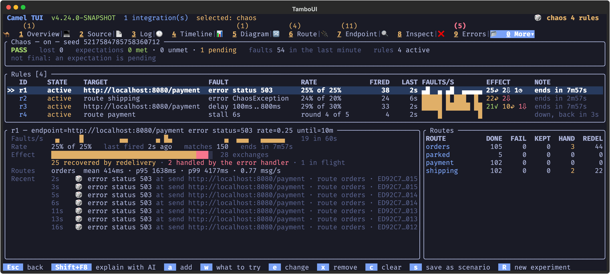
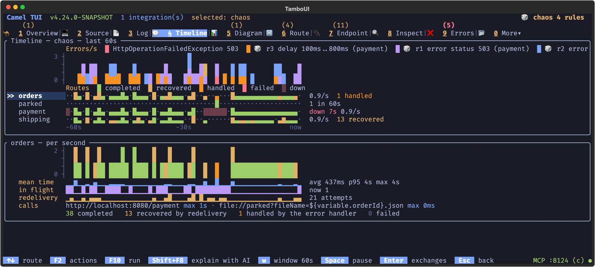

Camel has had error handling for a long time: redelivery, `onException`, the dead letter channel and the circuit
breaker. Usually you only find out whether your configuration works when a remote service is down in production.

Camel 4.24 brings [camel-chaos](/components/next/others/chaos.html), which adds faults to a running integration while
you develop it, and reports per route what completed, what a retry recovered, what the dead letter channel handled, and
what was lost. Chaos is only on with profile `dev` (the default of `camel run`), never with `prod`.

In [part 2](/blog/2026/11/let-there-be-chaos/) an AI picks and runs the faults by itself.

## Try it with the example

The [chaos example](https://github.com/apache/camel-jbang-examples/tree/main/fail-well/chaos) is a small web shop. It
takes an order every second, charges it at a payment service over HTTP, and hands it to shipping. A dead letter channel
with two retries parks the orders it could not charge as files.

```shell
camel run * --chaos
```

Chaos can read the routes and suggest what to try first:

```text
$ camel cmd chaos-suggest
Chaos rules to try, the most worth trying first:

1. route orders: Returns an error (HTTP status) (errors)
   an HTTP call to http://localhost:8080/payment without a circuit breaker: what does the route do when the service answers 503?
   camel cmd chaos-add --rule='endpoint=http://localhost:8080/payment error status=503 rate=0.25 until=10m expect=orders:failed<=0'

2. route orders: The route after a hand-off fails (lost)
   route orders hands the message to route shipping over seda and does not wait: when shipping fails, is the message lost?
   camel cmd chaos-add --rule='route=shipping error rate=0.2 until=2m expect=orders->shipping:lost<=0 within=3m'
```

A rule is one line: target, fault, how often, for how long, and optionally what must still hold:

```text
$ camel cmd chaos-add --rule='endpoint=http://localhost:8080/payment error status=503 rate=0.25 until=10m'
Added chaos rule r1: fail 25% of the sends to http://localhost:8080/payment with HTTP status 503, for 10 minutes
```

`camel get chaos` shows the effect while it runs, here `60 recovered, 4 handled`: 60 orders were saved by a retry and
4 went to the dead letter channel. None were lost.

## In the Camel TUI

In the [Camel TUI](/manual/camel-jbang-tui.html), press `F2`, choose *Run an Example...*, pick the chaos example and
tick *[x] Chaos testing*. On the chaos screen (`0` for More, then *Chaos*), `a` adds a rule: you pick the fault from a
list and the endpoints and routes with the arrow keys, so you do not need to know the rule syntax. `w` shows the
suggestions.



The chaos screen lists the rules, their live rate and what the faults did:



On the timeline, route `payment` was taken down twice for six seconds, with redeliveries in `orders` meanwhile:



## When the dead letter channel fails too

Take the payment service down for ten seconds and fail the dead letter channel too:

```shell
camel cmd chaos-add --rule='endpoint=http://localhost:8080/payment error status=503 until=10s' \
  --rule='endpoint=direct:parked error at=dlq until=10s'
```

The orders from those ten seconds are neither charged nor parked, and the log only has a WARN for each. Chaos reports
them as lost:

```text
chaos (pid 58473): FAIL
  lost: 9
  FAIL: rule r5 failed or dropped 9 sends of the dead letter channel, which handled them without delivering them: 9 lost
```

## A scenario as a gate in your build

A scenario is a `.chaos` file in `test/chaos` with one rule per line and a seed, so it fails the same messages each run:

```text
seed=42

# one call in four fails for 20 seconds: the redeliveries recover them, and the shop still takes 20 orders
endpoint=http://localhost:8080/payment error status=503 rate=0.25 until=20s expect=orders:20 within=25s
# shipping fails one message in five for 15 seconds: its redeliveries still ship every order charged
route=shipping error rate=0.2 until=15s expect=orders->shipping:lost<=0 within=20s
# then the payment service is down for 10 seconds: every order is charged or parked, none fails
route=payment stall duration=10s from=+20s expect=orders:failed<=0 within=15s
```

```shell
camel run * --chaos=test/chaos/payment-outage.chaos --max-seconds=45
```

It ends with `Chaos verdict: PASS (3 expectations met)` and exits with 0 for PASS and 1 for FAIL, so CI can fail the
build when a change to the error handling loses orders. In the TUI, `s` saves the rules you tried
by hand as such a file.

## It found a bug on the first day

An AI agent wrote the example, ran it with chaos rules and read the log. An order in `shipping` went to the dead
letter channel after one failure instead of two retries: its payment had needed two retries in route `orders`, and the
error handler in `shipping` kept counting from that redelivery counter
([CAMEL-26734](https://issues.apache.org/jira/browse/CAMEL-26734)).

I have wanted chaos in Camel for a long time. Now you can run the integration as it is, break it with chaos, and check
it with a [Citrus](https://citrusframework.org/) test or the deterministic simulation tests of `camel-test-dst`.

## There is more

- **More faults**: `delay` with a range (`duration=100ms..2s`), `drop` a send or a poll, `duplicate` a send to test an
  idempotent receiver, and `corrupt` a message (headers, charset or body).
- **Where**: the reply of a call (`at=reply`), the polls of a consumer (`at=poll`), a route, a single step or the
  dead letter channel (`at=dlq`), narrowed with `in=orders` or `when="${header.country} == 'ES'"`.
- **When**: a probability (`rate=0.3`), every Nth message (`rate=every:5`), outage windows (`rate=burst:5s/30s`) or
  after a warm-up (`from=+30s`), always for a limited time.
- **Routes that flap**: `stall`, and `lifecycle` to stop or remove and re-add a route, with `repeat=3 every=1m`.
- **Expectations**: on completed, handled or redelivered exchanges, on exchange time (`expect=orders:meanTime<=2s`),
  and on messages lost between two routes.
- **From a real error to a regression test**: on the Errors screen of the TUI, `!` turns a real error into a rule that
  fails the same way, and `t` on a rule asks the AI panel to write a JUnit test with `ChaosAssertions`, or a scenario.
- **MCP**: the Camel MCP server has the chaos operations as tools.
- **In tests**: `Main`, `CamelTestSupport`, and `camel-test-dst`, where a ten minute stall takes milliseconds of virtual time.
- **Spring Boot**: `camel run --chaos` works with `--runtime=spring-boot`. A camel-quarkus-chaos extension is on its
  way.

See the [documentation](/components/next/others/chaos.html) for the details.

## Try it

Camel 4.24 is not released yet, but the example runs with a 4.24 snapshot of the Camel CLI. Next, in
[part 2](/blog/2026/11/let-there-be-chaos/), an AI explores the same shop for ten minutes. Let us know what chaos
finds in your routes on the [mailing list or Zulip chat](/community/support/), or in
[Jira](https://issues.apache.org/jira/projects/CAMEL).
