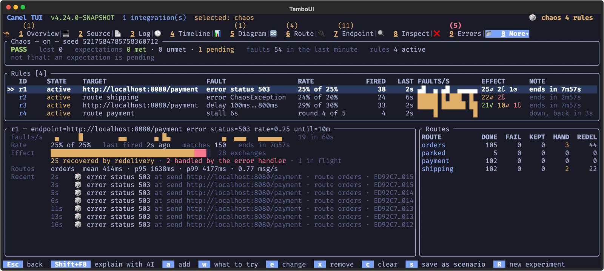
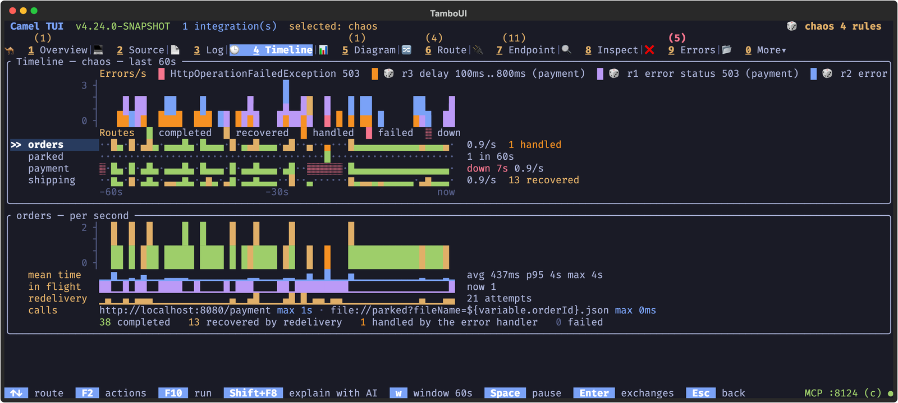

Camel has had error handling for as long as Camel has existed: redelivery, `onException`, the dead letter channel, and
later the circuit breaker. You configure them, and then you hope. The day you find out whether they work is the day
the payment service is down in production.

Camel 4.24 brings [camel-chaos](/components/next/others/chaos.html): turn on faults in a running integration while you
develop it, and see how the routes cope. "Fail 25% of the calls to the payment service for 10 minutes." "Stall route
`payment` for 10 seconds." "Fail the dead letter channel too." Then a report says per route what completed, what was
recovered by a retry, what the dead letter channel handled, and what was lost.

Chaos is for development only: it is on with profile `dev`, the default of `camel run`, and never with profile `prod`.

## Try it with the example

The new [chaos example](https://github.com/apache/camel-jbang-examples/tree/main/fail-well/chaos) is a small web
shop. It takes an order every second, charges it at a payment service over HTTP, and hands it to shipping. A dead
letter channel with two retries parks the orders it could not charge as files. Nothing in it fails on its own.

```shell
camel run * --chaos
```

Where do you start, with routes you did not write? Ask the integration. Chaos reads the routes and suggests what is
worth trying first:

```text
$ camel cmd chaos-suggest
Chaos rules to try, the most worth trying first:

1. route orders: Returns an error (HTTP status) (errors)
   an HTTP call to http://localhost:8080/payment without a circuit breaker: what does the route do when the service answers 503?
   camel cmd chaos-add --rule='endpoint=http://localhost:8080/payment error status=503 rate=0.25 until=10m'

2. route orders: The route after a hand-off fails (lost)
   route orders hands the message to route shipping over seda and does not wait: when shipping fails, is the message lost?
   camel cmd chaos-add --rule='route=shipping error rate=0.2 until=2m expect=orders->shipping:lost<=0 within=3m'
```

A rule is one line: what it targets, the fault, how often and for how long, and what must still hold. Add the first
one, and the payment service answers 503 to one call in four:

```text
$ camel cmd chaos-add --rule='endpoint=http://localhost:8080/payment error status=503 rate=0.25 until=10m'
Added chaos rule r1: fail 25% of the sends to http://localhost:8080/payment with HTTP status 503, for 10 minutes
```

The log fills with retries, and once in a while an order fails three times in a row and is parked. `camel get chaos`
shows the effect of the rule as it runs: `60 recovered, 4 handled`. Sixty orders were saved by a retry, four went to
the dead letter channel. Nothing was lost.

## Watch it happen

The Camel TUI has a chaos screen with the rules, their live rate, the faults per second, and what the faults did to
the exchanges they hit. You can add, change and remove rules there too, and press `w` for what to try.



The timeline shows per second the faults of each rule and what each route did. Here route `payment` was taken down
for six seconds, twice, and you can see the redeliveries in `orders` while it was gone:



## When the last safety net fails

The dead letter channel is the last safety net. So what if it fails too? Take the payment service down for ten
seconds, and fail the dead letter channel at the same time:

```shell
camel cmd chaos-add --rule='endpoint=http://localhost:8080/payment error status=503 until=10s' \
  --rule='endpoint=direct:parked error at=dlq until=10s'
```

The orders of those ten seconds are neither charged nor parked. They are gone, and all the log has for each of them is
one more WARN among the retries. This is how messages get lost in production without anyone noticing. Chaos notices:

```text
chaos (pid 58473): FAIL
  lost: 9
  FAIL: rule r5 failed or dropped 9 sends of the dead letter channel, which handled them without delivering them: 9 lost
```

## A scenario as a gate in your build

Rules typed at the command line are an experiment. Rules in a file are a test. A scenario is a `.chaos` file with one
rule per line and a seed, so it fails the same messages every time it runs:

```text
seed=42

# one call in four fails for 20 seconds: the redeliveries recover them, and the shop still takes 20 orders
endpoint=http://localhost:8080/payment error status=503 rate=0.25 until=20s expect=orders:20 within=25s
# shipping fails one message in five for 15 seconds: its redeliveries still ship every order charged
route=shipping error rate=0.2 until=15s expect=orders->shipping:lost<=0 within=20s
# then the payment service is down for 10 seconds: every order is charged or parked, none fails
route=payment stall duration=10s from=+20s expect=orders:failed<=0 within=15s
```

```shell
camel run * --chaos=chaos/payment-outage.chaos --max-seconds=45
```

It ends with `Chaos verdict: PASS (3 expectations met)`, and the verdict is the exit code: 0 for PASS, 1 for FAIL.
So a CI pipeline can run it, and fail the build when a change to the error handling loses orders. In the TUI, `s` saves
the rules you tried by hand as such a file.

## Chaos found a bug on its first day

While writing the example, one order in `shipping` went to the dead letter channel after a single failure, without
the two retries it should have had. It was an order whose payment had needed two retries earlier, in route `orders`.
The redelivery counter of that first error handler stayed on the message, and the error handler in `shipping` started
counting from it. That is exactly the kind of thing chaos is for: a bug that hides until two failures meet.
<!-- TODO Claus: JIRA for the redelivery counter that carries over to the next error handler -->

## There is more

The example shows a few of the faults. Some more of what chaos can do:

- **More faults.** `delay` with a range (`duration=100ms..2s`), `drop` a send or a poll, `duplicate` a send to test
  that the receiver is idempotent, and `corrupt` a message (random headers, a wrong charset, a truncated or empty
  body, a missing header).
- **Where it hits.** At the send, at the reply of a call that succeeded (`at=reply`), at the polls of a consumer
  (`at=poll`), at the entry of a route, at a single step, or at the dead letter channel (`at=dlq`). Narrow a rule to
  the calls of one route with `in=orders`, or to some messages with `when="${header.country} == 'ES'"`.
- **When it hits.** A probability (`rate=0.3`), every Nth message (`rate=every:5`), outage windows
  (`rate=burst:5s/30s`), after the warm-up (`from=+30s`), and always for a limited time: a forgotten rule cannot keep
  breaking your development instance.
- **Routes that flap.** `stall` suspends a route, `lifecycle` stops it or removes it and adds it back, and
  `repeat=3 every=1m` does it again and again.
- **Expectations.** At least so many orders completed, nothing handled by the dead letter channel
  (`expect=orders:handled<=0`), a limit on the redeliveries, the mean or max time of an exchange
  (`expect=orders:meanTime<=2s`), and no message lost between two routes.
- **From a real error to a regression test.** On the Errors screen of the TUI, `!` turns a real error into a rule
  that fails the same way again: fix the bug, then prove the fix against the same failure. And `t` on a rule asks the
  AI panel to make a test of it: a JUnit test with `ChaosAssertions`, or a scenario.
- **For AI agents.** The Camel MCP server has the chaos operations as tools, so an agent can ask what to try, check a
  rule before it adds it, and read the report.
- **In tests.** Chaos runs in a plain `Main`, a `CamelTestSupport` test, and in the deterministic simulation tests of
  `camel-test-dst`, where a ten minute stall takes milliseconds of virtual time.
- **Spring Boot.** `camel run --chaos` works with `--runtime=spring-boot` too, and for Quarkus a camel-quarkus-chaos
  extension is on its way.

The [documentation](/components/next/others/chaos.html) has all of it.

## Try it

Camel 4.24 is not released yet. If you want to try chaos now, the example runs with a 4.24 snapshot of the Camel CLI.
We would love to hear what chaos finds in your routes, and what you miss: tell us on the
[mailing list or Zulip chat](/community/support/), or in [Jira](https://issues.apache.org/jira/projects/CAMEL).

Happy breaking.
