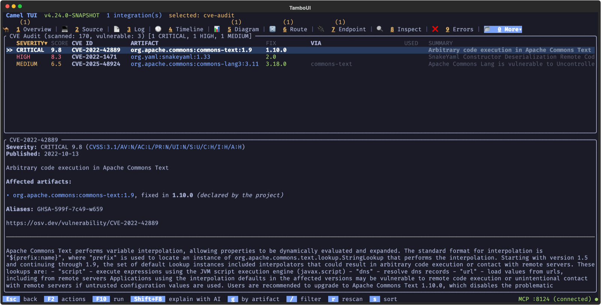
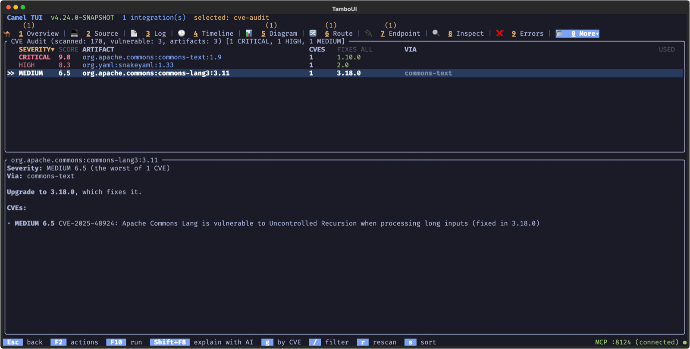

Any scanner gives you a list of CVEs in your dependencies. Camel 4.24 also tells you which version fixes the JAR you
have, how it got onto your classpath, and whether your routes use it. The audit is on the CVE Audit screen of the
[Camel TUI](/manual/camel-jbang-tui.html), in a new command, `camel dependency audit`, and in a Maven goal,
`camel-report:audit`.

## Try it with the example

The new [CVE audit example](https://github.com/apache/camel-jbang-examples/tree/main/security/cve-audit) declares two
outdated libraries on purpose:

```properties
# DELIBERATELY OUTDATED: two libraries with known CVEs
camel.jbang.dependencies=org.apache.commons:commons-text:1.9,org.yaml:snakeyaml:1.33
```

commons-text 1.9 has Text4Shell (CVE-2022-42889) and a bean uses it. snakeyaml 1.33 has CVE-2022-1471 and is not
used. Run the audit in the example's folder:

```text
$ camel dependency audit
 SEVERITY  SCORE  CVE             ARTIFACT                               FIX     VIA           USED  SUMMARY
 CRITICAL    9.8  CVE-2022-42889  org.apache.commons:commons-text:1.9    1.10.0                      Arbitrary code execution in Apache Commons Text
 HIGH        8.3  CVE-2022-1471   org.yaml:snakeyaml:1.33                2.0                         SnakeYaml Constructor Deserialization Remote Code Executi…
 MEDIUM      6.5  CVE-2025-48924  org.apache.commons:commons-lang3:3.11  3.18.0  commons-text        Apache Commons Lang is vulnerable to Uncontrolled Recursi…

3 vulnerabilities in 3 of 27 dependencies of the project (1 CRITICAL, 1 HIGH, 1 MEDIUM)
```

commons-lang3 3.11 was not declared; VIA shows it came in with commons-text.

## Which version fixes it

A vulnerability record lists fixed versions for every line of a library: "2.12.7.1, 2.13.4, 2.14.0, 2.15.0". FIX is
the one for your line: 2.13.2 gets 2.13.4.

For Camel JARs the audit also checks the Apache Camel [security advisories](/security/) in the Camel catalog, so
camel-salesforce 4.18.1 gets "Camel 4.18.3", the patch release of your own line. The advisories work without the
vulnerability database; `--offline` checks only those.

## What to upgrade

`--by-artifact` shows one row per JAR, with the version that fixes all its CVEs:

```text
$ camel dependency audit --by-artifact
 SEVERITY  SCORE  ARTIFACT                               CVES  FIXES ALL  VIA           USED
 CRITICAL    9.8  org.apache.commons:commons-text:1.9       1  1.10.0
 HIGH        8.3  org.yaml:snakeyaml:1.33                   1  2.0
 MEDIUM      6.5  org.apache.commons:commons-lang3:3.11     1  3.18.0     commons-text
```

commons-text 1.10.0 fixes Text4Shell but still brings commons-lang3 3.12.0, which is also vulnerable. The first
commons-text with a fixed commons-lang3 is 1.14.0, so the example needs commons-text 1.14.0 or later, and no snakeyaml.
Camel brings snakeyaml 2.x itself, so the example has both 1.33 and 2.x on the classpath. After upgrading, check the
Classpath screen of the Camel TUI.

## How did it get here, and is it used?

VIA is the dependency chain to the vulnerable JAR, worked out from the POMs on the classpath. With Kafka:

```text
 SEVERITY  SCORE  CVE             ARTIFACT                                FIX       VIA                          USED
 HIGH        7.5  CVE-2023-43642  org.xerial.snappy:snappy-java:1.1.10.1  1.1.10.4  camel-kafka > kafka-clients  yes
```

USED is `yes` when your routes have an endpoint of the Camel connector that brings the JAR in (here `kafka:`), `no`
when they have none, and empty when no connector brings it in. A `yes` does not mean you are affected: the snappy CVE
is in decompressing snappy data, so it matters only when the Kafka messages are snappy-compressed.

## In the Camel TUI

The CVE Audit screen (under More > Project) audits a running integration, using the JARs it loaded. `g` groups by
artifact, `/` filters, and the detail panel shows the description, the Camel advisory with its mitigation, and the
fix version.





`Shift+F8` sends a vulnerability or artifact to the AI panel with the suggested change, and asks whether the
integration is affected given its routes and configuration. It changes no file unless you agree.

```text
Suggested changes:
- org.apache.commons:commons-text: use org.apache.commons:commons-text:1.14.0 where the project declares it (//DEPS,
  camel.jbang.dependencies or --dep)
```

In the example the integration is not exposed: Text4Shell is in the commons-text *interpolator* (script, dns and url
lookups), and the bean uses a `StringSubstitutor` with a plain map of values from a timer. Upgrading is still the fix.

## In your build

`camel dependency audit` exits with 1 when it finds a vulnerability, so a CI job fails:

```shell
# fail on critical ones only, list high and worse
camel dependency audit --fail-on=critical --severity=high
```

`--fail-on=none` never fails, and `--json` prints JSON. By default it audits the project files, resolving dependencies
as Maven does; `--integration=<name>` audits a running integration instead.

A Maven project does not need the CLI for this. The `audit` goal of the
[camel-report-maven-plugin](/manual/camel-report-maven-plugin.html#_camel_reportaudit) runs the same checks on the
dependencies Maven resolved for the build, with the versions your BOMs chose:

```text
$ mvn camel-report:audit -Dcamel.audit.byArtifact=true
[WARNING] SEVERITY  SCORE  ARTIFACT                               CVES  FIXES ALL  VIA
[WARNING] CRITICAL    9.8  org.apache.commons:commons-text:1.9       1  1.10.0
[WARNING] HIGH        8.3  org.yaml:snakeyaml:1.33                   1  2.0
[WARNING] MEDIUM      6.5  org.apache.commons:commons-lang3:3.11     1  3.18.0     commons-text
[WARNING] 3 vulnerabilities in 3 of 3 dependencies of com.acme:orders
```

By default the goal only reports. Add it to the `pom.xml` and it fails the build at `verify`:

```xml
<plugin>
  <groupId>org.apache.camel</groupId>
  <artifactId>camel-report-maven-plugin</artifactId>
  <version>${camel.version}</version>
  <executions>
    <execution>
      <goals>
        <goal>audit</goal>
      </goals>
      <configuration>
        <failOn>high</failOn>
      </configuration>
    </execution>
  </executions>
</plugin>
```

The goal writes `target/camel-audit.json` and `target/camel-audit.sarif`, which GitHub code scanning shows in the
Security tab. A vulnerability that does not apply goes in `camel-audit-suppressions.txt` with the reason. The goal has
no USED column, as it does not look at the routes.

## Fixed along the way

`camel run` loads declared dependencies (`camel.jbang.dependencies`, `//DEPS`, `--dep`) in its own class loader, so
the TUI, which read the JVM classpath, did not see them. The CVE Audit, Classpath and Heap Histogram screens now do.

## Try it

Camel 4.24 is not released yet. The [example](https://github.com/apache/camel-jbang-examples/tree/main/security/cve-audit)
runs with a 4.24 snapshot of the Camel CLI, and the [documentation](/manual/camel-jbang-projects.html) lists the options.
Tell us what it finds and what you miss on the [mailing list or Zulip chat](/community/support/), or in
[Jira](https://issues.apache.org/jira/projects/CAMEL).
