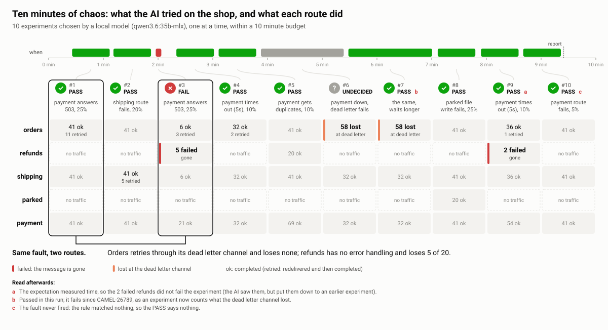

In [part 1](/blog/2026/11/camel-chaos/) you added the chaos rules yourself, which means you have to know what to try.
In Camel 4.24 you can leave that to the AI of `camel ask`:

```shell
camel cmd chaos-explore shop --budget=10m
```

For ten minutes it picks faults, runs them as experiments and reads the verdicts, then writes a report of what held
and what broke, with a hint per finding. It does not change your routes.


## The shop

The shop is the [chaos example](https://github.com/apache/camel-jbang-examples/tree/main/fail-well/chaos) from part
1, plus a route that takes refunds from Kafka and pays them back at the payment service. The refunds route has no
error handling of its own. Kafka is stubbed, so no broker is needed. The model is qwen3.6 (35B), running locally on
a laptop.

```shell
camel run * --chaos --stub=kafka --name=shop
camel cmd chaos-explore shop --budget=10m
```

## The run



In experiments 1 and 3 the payment service answers 503 to a quarter of the calls. The orders retried 11 calls and all
got through. The refunds have no retry, so 5 of 20 failed and are gone. The AI then looked up the errors on its own:

> The refunds route failed with `HttpOperationFailedException` - it has no error handling for the HTTP call to
> payment. [...] This is a real issue: the refunds route needs better error handling (like an onException with
> redelivery or a dead letter channel).

The journal, with the hypotheses as the AI wrote them:

| # | Hypothesis | Verdict | Evidence |
|---|---|---|---|
| 1 | When payment returns 503, orders should retry and not lose messages | PASS | 0 failed, 11 retried |
| 2 | When shipping fails, orders should not lose the message handed off via seda | PASS | 0 lost (39 in orders, 39 in shipping) |
| 3 | When payment returns 503, refunds should handle errors gracefully | **FAIL** | **5 failed** |
| 4 | When payment times out, orders should retry and complete within reasonable time | PASS | max 5.5s of 31 orders |
| 5 | When payment receives duplicates, refunds should handle them safely | PASS | 0 failed |
| 6 | When payment fails and the dead letter channel also fails, orders should not lose messages entirely | undecided | the window was longer than the wait |
| 7 | The same, again with a shorter window | PASS | 0 failed (58 lost at the dead letter channel) |
| 8 | When the file write fails, parked should handle the error gracefully | PASS | 0 failed, 7 handled |
| 9 | When payment times out, refunds should complete within reasonable time | PASS | max 5s (2 failed) |
| 10 | When the payment route fails, HTTP clients should see proper error responses | PASS | the fault never fired |

## One experiment per call

Each experiment is one tool call with a hypothesis, a rule and the test messages to send, simple enough for a small
local model. Camel adds the rule, sends the messages, waits for the verdict and removes the rule.
The same by hand:

```shell
camel cmd chaos-explore-start --budget=10m
camel cmd chaos-experiment --hypothesis='a failed refund is retried, not lost' \
    --rule='endpoint=http://localhost:8080/payment error status=503 rate=0.25 until=30s expect=refunds:failed<=0 within=40s' \
    --feed=refunds --body='{"refundId": "R-1"}' --repeat=20 --interval=100..300
camel cmd chaos-explore-finish
```

## Limits

Chaos only runs with profile `dev`. The exploration has a deadline (10 minutes by default, 2 hours at most), and then
all rules are removed, even if the AI has crashed. Remote systems are stubbed, and the AI only adds faults and sends
test messages; it does not edit your project.

## What you keep

The results go to `test/chaos`, which `camel run` and `camel export` leave alone: the report and journal in
`test/chaos/reports/explore-<time>.md` (and a `.json` the picture above is drawn from), and each failed
experiment as a scenario in `test/chaos/explore-<time>-<n>.chaos`:

```text
# From the chaos exploration of shop on 2026-11-09 18:14, experiment 3: FAIL
# hypothesis: When payment returns 503, refunds should handle errors gracefully
# expect refunds:failed<=0: unmet, 5 failed
seed=-7420423075154098588
endpoint=http://localhost:8080/payment error status=503 rate=0.25 until=30s expect=refunds:failed<=0 within=40s
```

Load it with `camel cmd chaos-load` or `camel run * --chaos=...` and it fails until you fix the route. Then keep it
in your pipeline, as in part 1.

## Where the model slipped

The red letters in the picture mark the mistakes:

- **a**: In experiment 9 it measured time, not failures, so 2 failed refunds passed. It saw them and blamed an earlier
  experiment.
- **b**: Experiments 6 and 7 passed while orders were lost at the dead letter channel. That was Camel, which did not
  count those losses yet. It is fixed, and such an experiment now fails. Another run reported 2 messages lost at the
  dead letter channel.
- **c**: In experiment 10 the fault never fired, so the PASS means nothing.

Earlier runs also fed messages to endpoints no route reads from, or added rules that matched nothing. Camel now
rejects or warns about these, and the model corrects itself. A bigger model makes better choices, and the
journal has the evidence to check each finding.

## Other agents

The same playbook is an MCP prompt, `camel_chaos_explore`, so Claude Code or any agent with the Camel MCP server can
run it with the `camel_runtime_chaos_*` tools.

Try it with Camel 4.24, and tell us what it found in your routes.
