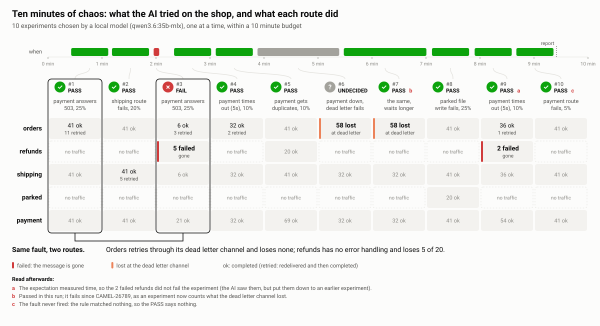

In [part 1](/blog/2026/11/camel-chaos/) you added the faults yourself: "fail a quarter of the payment calls",
"fail the dead letter channel too", and then you read the report. That works, but it means you have to know what to
try. With Camel 4.24 you can hand that part to an AI as well:

```shell
camel cmd chaos-explore shop --budget=10m
```

Let there be chaos. For ten minutes the AI of `camel ask` explores how the integration copes with faults, by
itself. It reads what the routes do, picks a fault to try, says what should hold, runs the experiment, reads the
verdict, and goes on. At the end it writes a report: what held, what broke and why, and a hint for each finding. The
integration keeps running; the AI never changes your routes.


## The shop

The shop is the one from the [chaos example](https://github.com/apache/camel-jbang-examples/tree/main/fail-well/chaos):
an order every second, charged at a payment service over HTTP, handed to shipping, with a dead letter channel that
parks what could not be charged. We added one route: refunds arrive on Kafka and are paid back at the payment
service. The refunds route has no error handling of its own. That is the kind of gap you want found before
production. Kafka is stubbed (`camel run --stub=kafka`), so no broker is needed and nothing real is touched.

```shell
camel run * --chaos --stub=kafka --name=shop
camel cmd chaos-explore shop --budget=10m
```

The model is qwen3.6 (35B), running locally on a laptop. No cloud, no API key.

## Ten minutes, in one picture

Here is the whole run. Along the top, when each experiment ran within the budget; below, one column per experiment,
with what it did to each route:



Look at columns 1 and 3. It is the same fault both times: the payment service answers 503 to a quarter of the calls.
The orders retried 11 calls through their dead letter channel, and every order got through. The refunds have no
retry: 5 of the 20 failed, and they are gone.

The AI did not stop at the verdict. It looked up the errors of the integration by itself and explained what it saw:

> The refunds route failed with `HttpOperationFailedException` - it has no error handling for the HTTP call to
> payment. [...] This is a real issue: the refunds route needs better error handling (like an onException with
> redelivery or a dead letter channel).

That is the finding, the evidence and the hint, in the AI's own words, without anybody telling it where to look.

In another run it went for the nastier case: the payment service down, and the dead letter channel failing too.
The dead letter channel then handles the orders it could not park, so they neither fail nor complete: they are just
gone. That run reported "when payment returned 503 and the dead letter channel also failed, 2 messages were lost at
the dead letter channel" (columns 6 and 7 above are the same experiment, before Camel counted those losses; more on
that below).

## The journal

Every experiment goes into the journal of the exploration, with the hypothesis the AI wrote for it and the evidence
for the verdict. These are the ten experiments of the run, as the AI phrased them:

| # | Hypothesis | Expected | Verdict | Evidence |
|---|---|---|---|---|
| 1 | When payment returns 503, orders should retry and not lose messages | orders: failed ≤ 0 | PASS | 0 failed, 11 retried |
| 2 | When shipping fails, orders should not lose the message handed off via seda | orders→shipping: lost ≤ 0 | PASS | 0 lost (39 in orders, 39 in shipping) |
| 3 | When payment returns 503, refunds should handle errors gracefully | refunds: failed ≤ 0 | **FAIL** | **5 failed** |
| 4 | When payment times out, orders should retry and complete within reasonable time | orders: max time ≤ 30s | PASS | max 5.5s of 31 orders |
| 5 | When payment receives duplicates, refunds should handle them safely | refunds: failed ≤ 0 | PASS | 0 failed |
| 6 | When payment fails and the dead letter channel also fails, orders should not lose messages entirely | orders: failed ≤ 0 | undecided | the window was longer than the wait |
| 7 | The same, again with a shorter window | orders: failed ≤ 0 | PASS | 0 failed (58 lost at the dead letter channel) |
| 8 | When the file write fails, parked should handle the error gracefully | parked: failed ≤ 0 | PASS | 0 failed, 7 handled |
| 9 | When payment times out, refunds should complete within reasonable time | refunds: max time ≤ 30s | PASS | max 5s (2 failed) |
| 10 | When the payment route fails, HTTP clients should see proper error responses | payment: failed ≤ 0 | PASS | the fault never fired |

The AI kept to its budget: with 38 seconds left it said that was not enough for another experiment, and finished.

## One experiment per call

The trick that makes this work with a small local model is that each experiment is a single tool call. The model
does not juggle rules, traffic and timers; it says what it wants to know:

```json
{
  "hypothesis": "When payment returns 503, refunds should handle errors gracefully",
  "rule": "endpoint=http://localhost:8080/payment error status=503 rate=0.25 until=30s expect=refunds:failed<=0 within=40s",
  "feed": "refunds", "body": "{\"refundId\": \"R-1\"}", "repeat": 20, "interval": "100..300"
}
```

Camel adds the rule, sends the 20 refunds to the stubbed Kafka topic, waits until the expectation is decided, removes
the rule, and answers with the verdict, the counts per route and the traffic. You can do exactly the same by hand,
without any AI:

```shell
camel cmd chaos-explore-start --budget=10m
camel cmd chaos-experiment --hypothesis='a failed refund is retried, not lost' \
    --rule='endpoint=http://localhost:8080/payment error status=503 rate=0.25 until=30s expect=refunds:failed<=0 within=40s' \
    --feed=refunds --body='{"refundId": "R-1"}' --repeat=20 --interval=100..300
camel cmd chaos-explore-finish
```

## Safe by construction

You say yes once, by starting the exploration, and Camel holds the line from there, whatever the model does:

- Chaos only runs in development (profile `dev`), never with `prod`.
- The exploration has a deadline (10 minutes by default, 2 hours at most). Every rule ends at the deadline at the
  latest, and at the deadline all rules are removed, even if the AI has crashed or lost its context.
- Remote systems are stubbed, so the experiments do not reach your real Kafka or payment provider.
- The AI only adds faults and sends test messages to the routes; it does not edit your project.

## What you keep

Everything ends up in `test/chaos`, which `camel run` and `camel export` leave alone:

- `test/chaos/reports/explore-<time>.md`: the report of the AI and the journal of all experiments, and a `.json` next
  to it for tools. The picture above is drawn from that `.json`.
- `test/chaos/explore-<time>-<n>.chaos`: each experiment that failed, as a scenario:

```text
# From the chaos exploration of shop on 2026-11-09 18:14, experiment 3: FAIL
# hypothesis: When payment returns 503, refunds should handle errors gracefully
# expect refunds:failed<=0: unmet, 5 failed
seed=-7420423075154098588
endpoint=http://localhost:8080/payment error status=503 rate=0.25 until=30s expect=refunds:failed<=0 within=40s
```

Load it again (`camel cmd chaos-load`, or `camel run * --chaos=...`), send some refunds, and the verdict is FAIL
again, until you fix the route. Then keep it as a test that gates your pipeline.

## Honest about the model

A small local model is not a chaos engineer, and the picture shows where it slipped (the red letters):

- **a**: In experiment 9 it measured time, not failures, so 2 failed refunds passed. It saw them, and put them down
  to an earlier experiment.
- **b**: Experiments 6 and 7 passed while orders were lost at the dead letter channel. That one was on Camel, not
  on the model: the experiment did not count those losses yet. The run showed it, and it is fixed: such an experiment
  now fails.
- **c**: In experiment 10 the fault never fired, so its PASS says nothing.

Our earlier runs were rougher: thresholds such as `failed<=5` that hide what was lost, messages fed to an endpoint
no route reads from, rules that matched nothing. Each of those made an experiment that said nothing, so we made
Camel catch them: an experiment refuses a feed that reaches no route (and lists the routes it can feed), warns when
a rule matches nothing, waits until its expectations can decide, and counts what the dead letter channel lost. The
model reads why and corrects itself. A bigger model makes better choices, and the journal always carries the
evidence, so you can judge each finding yourself.

## Any agent

The same playbook is an MCP prompt, `camel_chaos_explore`, so Claude Code, or any agent with the Camel MCP server,
can run the same loop with the `camel_runtime_chaos_*` tools. And because each exploration is bound to one running
integration, you can imagine where this goes: several agents, each with its own copy of the integration, exploring
in parallel for an hour, and one agent that combines their reports.

Try it with Camel 4.24, and tell us what it found in your routes.
