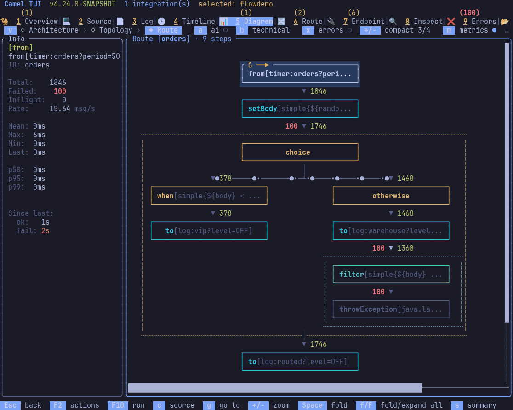

Apache Camel 4.24 has just been [released](/blog/2026/12/RELEASE-4.24.0/).

Camel 4.23 was the biggest Camel release in a long time, and Camel 4.24 is twice as big again. Since 4.23 we have resolved
**2076 JIRA tickets**: 1233 bug fixes, 533 improvements and 46 new features, made in over 3100 commits by 63 contributors.

More than 90% of the commits that were not made by bots were made with an AI coding assistant -- the rest are mostly
dependency and container image upgrades. Every change still went
through the usual Apache process -- JIRA, pull request, CI and review by the Camel committers.

Camel 4.24 is a release about reliability: tools that break your routes on purpose, tests that find the rare races
in Camel itself, and over 1200 bug fixes. The headline features in this release are:

- **Chaos testing** -- Break your routes on purpose while you develop them, and see whether your error handling does what you
  expect. An AI can do the exploring for you.
- **Bug fixes and security hardening** -- Over 1200 bug fixes in 233 components, and around 180 tickets about security.
- **A 10 times faster Camel CLI** -- A command now takes about 100 ms instead of more than a second. The CLI has moved from picocli to aesh,
  and has documented exit codes, JSON output and timeouts, so scripts and AI agents can trust it.
- **See the messages move** -- The route diagram of the Camel TUI shows the messages flowing through your routes live,
  and spots a stuck step for you.
- **CVE audit** -- Find out which version fixes a vulnerable JAR, how it got onto your classpath, and whether your routes use it.
- **Kamelets overhaul** -- Every Kamelet is documented, almost all are tested, and their data types now fit together.
- **SOAP without generated classes** -- XML to JSON driven by an XML Schema, and `camel generate wsdl` to scaffold a route from a WSDL.
- **Deterministic simulation testing** -- How we found the bugs that only happen once in a while: we control time,
  run thousands of scenarios in seconds, and replay a failing one exactly. A new exchange sanitizer checks that the
  routing engine keeps its own rules.
- **Java 21** -- Java 21 is now the minimum version, and Camel is upgraded to Spring Boot 4.2.

## Chaos Testing

Camel has had error handling for a long time: redelivery, `onException`, the dead letter channel and the circuit breaker.
Usually you only find out whether your configuration works when a remote service is down in production.

The new [Chaos](/components/next/others/chaos.html) module lets you find out while you develop. You turn on faults in the
running integration, such as "fail 30% of the sends to Kafka for one minute", and a rule can say what must still hold.
Saved as a scenario, the rules give a PASS or FAIL, so they can be a gate in your build. If you do not know what to try,
an AI can pick the faults and report what held and what broke. Chaos never turns on in production. Two blog posts on chaos testing follow next week.

## Bug Fixes and Security

### Over 1200 Bug Fixes

Most of the tickets in this release are bug fixes: 1233 of them, in 233 components. Many come from the AI-assisted scans of the
components that we started in Camel 4.23. A scan reads a component, its documentation and its tests, and finds where they
disagree. Typical finds are an option that has no effect, a header that is never set, a consumer that loses a message when it
stops, or a documented default the code does not have. Every fix comes with a test.

The bugs that only happen in a rare order of events are hard to find by reading code. For those we used
[deterministic simulation testing](#deterministic-simulation-testing) and [chaos testing](#chaos-testing).

### Security Hardening

The scans also looked for security problems, and around 180 tickets in this release are about security, including:

- **Credentials go only where they belong** -- the credentials of GraphQL, Elasticsearch and OpenSearch are bound to the configured
  host or cluster, and OAuth access tokens are sent only in the `Authorization` header.
- **TLS settings that had no effect are now applied** -- such as hostname verification in Netty, and the TLS options of gRPC, Thrift, MongoDB and Solr.
- **Message input is not trusted as configuration** -- more components use a header that overrides credentials or the target
  only when an option allows it (SSH, SMPP, Docker, Keycloak, DuckDB and more).
- **Secure defaults** -- webhooks verify their signatures by default, and the control bus `language` command is off by default.
- **Secrets** are masked in more places, and the security policy now also checks the beans that route files define.

Many of these fixes are also backported to the 4.22.x and 4.18.x LTS releases.

### Security Model

After the [38 security advisories](/blog/2026/10/camel-security-advisories-4.23.0/) published with Camel 4.23, we revisited the
[security model](/manual/security-model.html) of Camel: what Camel trusts, which security properties it provides, and which
classes of vulnerability are in scope. It helps you secure your integrations, and tells security researchers what counts as
a vulnerability in Camel.

### Authorization

The new [Cedar](/components/next/cedar-component.html) component evaluates [Cedar](https://www.cedarpolicy.com/) authorization
policies in-process, with no call to a remote service, and `CedarSecurityPolicy` guards a whole route.
It joins the authorization components from Camel 4.23, which have matured a lot:

- [OPA](/components/next/opa-component.html) -- atomic reload of WASM policy bundles, and the outcome of each item in a batch.
- [OpenFGA](/components/next/openfga-component.html) -- server-side batch checks, and a consumer of the change log with durable checkpoints.
- [SPIFFE](/components/next/spiffe-component.html) -- the verified identity of the peer on all the HTTP consumers, and readiness checks of the identity.

## Camel CLI

In Camel 4.24 a Camel CLI command takes about 100 ms, where 4.23 took more than a second (`camel ps`: 1201 ms, now 80 ms).
For an AI agent that calls the CLI 100 times for one task, that is 10 seconds of waiting instead of two minutes.

The CLI has also moved from picocli to [aesh](https://github.com/aeshell/aesh), and documents its [exit codes and output](/manual/camel-jbang-exit-codes.html)
as a contract for scripts, CI jobs and AI agents. The web installers and `camel self-update` can follow the latest release, the latest LTS, an `X.Y` line, or a nightly build.

Other improvements:

- `camel export --runtime=spring-boot --packaging=war` exports a WAR file for Tomcat.
- `camel cmd send --repeat=100 --interval=200ms` feeds a route with many messages.
- `camel export` and `camel run` are now also a Java API, so IDEs and other tools can export and run integrations the same way.
- `camel dependency outdated` lists the dependencies that have newer releases.

A blog post on the Camel CLI in 4.24 follows next week.

## Camel TUI

### See the Messages Move

The route diagram of the Camel TUI now shows where the messages go while the integration runs. Dots move along the arrows:
the more messages a second, the faster and closer together they are, and they turn red where most messages fail. At a choice
you see the dots split between the branches. A step where exchanges wait and none has finished for a few seconds gets a
spinner (`⠹ 3 inflight · 12s`), so a call to a system that does not answer is easy to spot:



The topology and architecture views show the same between routes and groups of routes. The live flow uses the counts
the diagram already loads, so it costs the integration nothing extra. Press `w` to turn it off and on.

### Other TUI Improvements

- **Body types** -- the Routes, Diagram and Source views show the body type at each step, so you can see how the body
  changes along a route (such as `LinkedHashMap → json` where a Kamelet converts it).
- **About** -- a new screen (and `camel get about`) says what an integration does and what has happened, at a glance and without AI.
- **Timeline** -- the errors and route outcomes of an integration per second, with the chaos rules as a layer.

## CVE Audit

Any scanner gives you a list of CVEs in your dependencies. `camel dependency audit` also answers the questions that come next:
which version fixes the JAR you have, how it got onto your classpath, and whether your routes use it at all.
It checks [OSV.dev](https://osv.dev/) and the [Apache Camel security advisories](/security/), or a local copy of the
vulnerability database if your dependency list must not leave the machine. It can fail your build, and Maven builds get the
same checks from the `camel-report:audit` goal. A blog post on the CVE audit follows next week.

## Kamelets

The Kamelet catalog has its biggest overhaul since Kamelets were introduced. Every Kamelet has a new description,
220 of the 236 are tested against real brokers and databases, about 40 old ones are gone, and there are new ones for SOAP,
PostgreSQL change data capture, OpenAI and AI agent tools.

Kamelets also fit together better. Camel now converts the message body to the type the next Kamelet expects, so CSV rows
go straight into a database sink without any code in between.

A blog post on the Kamelets in 4.24 follows next week.

## SOAP and XML

Many Camel users still integrate with SOAP web services, and Camel 4.24 makes this much easier, also from YAML routes
and Kamelets, without generating Java classes.

### XML to JSON driven by an XML Schema

The new [XSD JSON](/components/next/dataformats/xsdJson-dataformat.html) data format maps XML to JSON and back using an
XML Schema, or the types of a WSDL. Values get their JSON types, repeating elements are always arrays, and marshal writes
the elements in schema order with the correct namespaces:

```yaml
- route:
    from:
      uri: direct:reply
      steps:
        - unmarshal:
            xsdJson:
              schema: classpath:orders.wsdl
        - to:
            uri: mock:json
```

### Routes from a WSDL

`camel generate wsdl` lists the services, ports and operations of a WSDL, and scaffolds a route that serves or calls it:

```bash
camel generate wsdl orders.wsdl --route=consumer --output=orders-service.camel.yaml
camel generate wsdl orders.wsdl --route=producer --operation=getOrder --output=orders-client.camel.yaml
```

With `--samples` it writes a sample request and response for each operation, as XML, as JSON, and as a SOAP envelope
with a `curl` command to try it. The same is available as MCP tools, and as a WSDL view in the Camel TUI.

### SOAP on the Platform HTTP Server

The new [CXF Platform HTTP](/components/next/others/cxf-platform-http.html) module serves CXF consumers on the
platform HTTP server of Camel Main and the Camel CLI. They share the same port, TLS and authentication, so there is no need
for Jetty or Undertow. The CXF component also has first-class options for WS-Security UsernameToken, and a producer
with only a WSDL URL now calls the address from the WSDL.

## Finding the Rare Bugs

### Deterministic Simulation Testing

Some bugs only happen once in a few hundred runs: when a connection drops at the moment a commit is in flight, or when a
lock expires during a slow poll. Neither a reviewer nor an AI reading the code finds them reliably, and an ordinary test
does not hit them, because a test cannot choose the order in which things happen.

[Deterministic simulation testing](https://martinfowler.com/articles/deterministic-simulation-testing.html) (DST) turns this
around. The test controls the clock and decides when each part runs, so a consumer that waits 30 seconds for a lock to expire
costs nothing. And the same seed runs the same scenario again, in exactly the same order.

The new [Test DST](/components/next/others/test-dst.html) module brings this to Camel. It runs the real code of a Camel consumer
under a seeded, virtual-time scheduler. Only the external system is faked, by a *world*. The world injects faults chosen by the seed
and checks invariants at the end of each run, and thousands of runs take seconds:

```java
@DstInstrument("org.apache.camel.component.aws2.sqs")
class SqsVisibilityDstTest {

    @DstTest(seeds = 1000)
    void noMessageIsDeliveredAgainWhileTheConsumerHoldsIt(Dst dst) throws Exception {
        new SqsWorld(dst).run();
    }
}
```

A failing seed replays exactly with `-Ddst.seed=4711`, so a race that happened once becomes a test you can debug.
Camel 4.24 comes with worlds for Kafka, Kafka Share, AWS Kinesis and SQS, Azure Event Hubs and Service Bus,
Google Pub/Sub, MongoDB change streams, NATS JetStream, MQTT 5, Pulsar, Slack and the ZooKeeper master consumer.
The component pages list the worlds that test them.

These worlds found real bugs, some of them in code that had already been fixed once for a related problem:

- The MongoDB change streams consumer skipped the changes made while it reopened its change stream before the first message
  was routed -- in 50 of 2000 seeds.
- The AWS Kinesis consumer with `iteratorType=LATEST` skipped records when the iterator of a quiet shard expired -- in 44 of 2000 seeds.
- The Azure Service Bus lock renewer gave up after one transient error, so the lock expired and the message was delivered again
  -- in 27 of 1000 seeds.

Each of them was then reproduced with a plain unit test and fixed. Chaos testing found bugs the same way: by making the
faults happen, instead of hoping they happen in a test.

### Exchange Sanitizer

Some bugs are not in a component but in how code uses the routing engine. The new [Sanitizer](/components/next/others/sanitizer.html)
watches every step of a route and reports when one of the engine's rules is broken. For example, an async callback that is
called twice or never, a consumer commit that runs twice, or two threads that use the same exchange at the same time.
We use it with the Camel core tests to keep the routing engine honest, and it can check your own custom processors and
components too. In a test you add one annotation:

```java
@CamelSanitizer
class PriceRouteTest extends CamelTestSupport {
    ...
}
```

and with the Camel CLI:

```bash
camel run * --sanitizer
camel get sanitizer --report
```

### Testing with Citrus

The new [Citrus](/components/next/citrus-component.html) test component works like a mock endpoint that can also stand in
for a backend. It checks the messages a route sends to it with [Citrus](https://citrusframework.org/) message validation:
JSON, XML and YAML templates, JsonPath and XPath. The Citrus YAML tests of the Camel CLI (`camel test run`) are upgraded to
Citrus 5.2. We use them to test the Kamelets and the Camel CLI examples, and there is more to come (see the [roadmap](#roadmap)).

## A Faster Camel CI

None of this would be possible without a CI that we can trust. A year ago the Camel Core CI on Jenkins had between one and
four fully green builds per year. Today it has several per day, the build of main takes 1h24 instead of 5h45,
and a small pull request build takes 20 minutes instead of 35.

When much of the code is written with AI coding assistants, a reviewer can only trust a green build when green means something.
The CI also tests more: the Azure and Google Cloud integration tests now run on local emulators in containers, without a
real cloud account. Read how it was done in [Scaling the Apache Camel Core CI](/blog/2026/11/camel-core-ci-improvements/).

## Camel Core

### Simple Language

[Simple](/components/next/languages/simple-functions.html) has new functions for XML and JSON, such as `stripXmlNamespaces` and `isValidJson`,
which come in handy with SOAP payloads.

### Performance

We analyzed the cost of every exchange in the hot path of the routing engine: the time and memory used per step,
single- and multi-threaded, with JFR profiles. Each fix was prototyped and measured before it was made. The main ones:

- **JMX statistics that scale with threads** -- the JMX statistics are on as soon as `camel-management` is on the classpath.
  Every step of every exchange updated the same shared counters, so the threads fought over them, and adding threads did not
  add throughput. The counters now avoid that contention: on a 10-step route with 8 threads, the prototype ran 3.1 times faster
  (1.87 million instead of 604,000 exchanges a second).
- **Redelivery copies the message, not the exchange** -- with redelivery enabled (a very common production setup), the error handler
  made a full copy of the exchange at every step, just in case. It now keeps a copy of the message only: on a 10-step route
  the prototype used 72% less memory per exchange (2.4 KB instead of 8.7 KB), and 25% less time.
- **Smaller exchanges and messages** -- about 310 bytes less per exchange, and about 75 bytes less per message.
- **Type converter cache** -- a conversion such as `String` to `LoggingLevel` takes 14 ns instead of 1180 ns, and a failed lookup 165 ns instead of 2.6 µs.
- **Many routes** -- adding routes with ids, and removing or reloading all routes, is no longer quadratic in the number of routes.

There is more to do, and the remaining items are planned for Camel 4.25.

### Other Core Improvements

- The `binary` data type keeps a stream or file body instead of reading it into memory.
- A polling consumer reports DOWN in its health check while a poll hangs.
- `direct` and `kamelet` say *why* no consumer is available: the route and its status, the time waited, and a close name.
- Camel Main runs `transacted` routes with a local transaction manager when the application has one datasource.

## Camel AI

### Semantic EIPs

The [Semantic](/components/next/languages/semantic-language.html) language from Camel 4.23, which lets a route make decisions
on the *meaning* of a message, has grown up in Camel 4.24:

- **A new expert: OpenAI Decisions** -- the [Semantic OpenAI](/components/next/others/semantic-openai.html) expert asks the
  OpenAI Decisions API for typed yes/no, choice and score assessments. It never falls back to a chat completion, so the
  answer is always the type you asked for.
- **Images as input** -- an evaluation can assess text, images or both, so a route can decide on a photo of a parcel, a scanned
  document or a screenshot.
- **Experts are explicit** -- every evaluation names its expert, and the expert modules are split out:
  `camel-semantic-openai`, `camel-semantic-typesafe-ai` and `camel-semantic-wolf-defender` (local prompt-injection detection).
- **Metrics and audit** -- `camel-semantic-micrometer` exports the assessments as Micrometer metrics, and the audit and current
  measurements are shared by JMX, the dev console, the Camel TUI and the CLI.

For example, to decide whether a parcel is damaged from a photo:

```yaml
- beans:
    - name: vision
      type: org.apache.camel.semantic.openai.OpenAIDecisionsSemanticAdapter
      properties:
        endpointUri: "openai:decisions?model=gpt-6-luna"
        maxImageBytes: 10000000
- semantic:
    evaluation:
      damaged:
        expert: vision
        operation: boolean
        state: "${body}"
        parameters:
          instructions: Is the package visibly damaged?
          threshold: 0.5
          uncertainty: 0.1
          uncertaintyPolicy: fail
- route:
    from:
      uri: direct:inspect
      steps:
        - setVariable:
            name: damaged
            expression:
              simple:
                expression: "${semantic('damaged')}"
        - to: direct:route-policy
```

With `uncertaintyPolicy: fail`, an answer that is too close to the threshold fails the exchange instead of guessing,
so your error handling decides what happens to the parcels the model is not sure about.

### Governed AI Agents

A new [Governed AI Agents](/manual/governed-ai-agents.html) page in the user manual brings the pieces from Camel 4.23 and 4.24 together.
In Camel the tools of an AI agent are routes, so every tool call can be governed in the route that does the work:

- *Who is calling?* -- SPIFFE
- *May they do this?* -- authorization with OPA, OpenFGA, Cedar or roles
- *Does this action make sense?* -- a semantic guard decision
- *What happened?* -- GenAI observability

The page has examples in Java, XML and YAML.

### MCP

- The new [AI Prompt](/components/next/ai-prompt-component.html) component exposes a route as an MCP prompt. This completes
  the MCP support with tools (`ai-tool`), resources (`ai-resource`) and now prompts.
- An `ai-tool` route can name the roles its caller needs with `allowedRoles` (such as `allowedRoles: finance,controlling`).
  The roles come from the caller's token -- never from headers or tool arguments.
- The [MCP server](/components/next/others/mcp-server.html) of Camel Main and the Camel CLI supports MCP protocol version 2026-07-28,
  serving without sessions, OAuth with protected resource metadata (RFC 9728), an Origin check, and resource templates.
- The MCP server of the Camel CLI sends instructions to the agent in its `initialize` response: the rules an agent needs before its first call.

### GenAI Observability Levels

The GenAI observability from Camel 4.23 can now record much more, for backends built around LLM traces such as Langfuse.
With `camel.aiObservability.level=detailed`, an agent run becomes a span, with a child span for each model call and each
tool call. The `full` level also records the messages and the tool arguments and results, so use it only when your tracing
backend is allowed to store them. The agent runs, model calls and tool calls are also shown in a new `genai`
dev console, in the Camel TUI and through the MCP server.

### Other AI Changes

- `camel-openai` works without an API key, for local OpenAI-compatible servers such as Ollama, vLLM and LM Studio,
  and `jsonSchemaStrict=true` makes the model follow the JSON schema exactly.
- `CamelContentRetriever` turns any Camel endpoint into a LangChain4j `ContentRetriever` for RAG.
- `camel-ibm-watsonx-ai` has new `detectContext` and `detectGenerated` operations, and much more of the chat options of the SDK.
- AI events have a common `AiEvent` API and their own event type in Camel core.
- The Camel examples have an `AGENTS.md` that points coding agents to `llms.txt` and the Camel MCP server.

## Camel Kafka

### Exactly-Once

Kafka-to-Kafka routes can now be exactly-once (read-process-write): the offsets of the consumed records are committed in the
same transaction as the records the route produces:

```java
from("kafka:in?groupId=my-group&exactlyOnce=true&allowManualCommit=true&autoCommitEnable=false&breakOnFirstError=true")
    .to("kafka:out?exactlyOnce=true&transactionalId={{orders.kafka.transactional-id}}");
```

See the [Kafka](/components/next/kafka-component.html) documentation for the requirements.

### Schema Registry

Setting up a schema registry used to mean configuring the serializer, the deserializer and the registry login by hand.
The new `schemaRegistryVendor` option does it for you, for Confluent, Apicurio, AWS Glue and Azure, with Avro, JSON or Protobuf:

```text
kafka:orders?brokers=localhost:9092&schemaRegistryVendor=confluent&schemaRegistryURL=http://localhost:8081
```

The Camel CLI downloads the serde JARs of the vendor. The `kafka-source` and `kafka-sink` Kamelets also take a schema registry now.

### Other Kafka Changes

Many fixes for manual commits, rebalances and stopping consumers, some of them found by the new Kafka DST world.

## Other Component Highlights

- `camel-sjms` -- batch consuming is back (`batching=true`).
- `camel-milo` -- one consumer can subscribe to many OPC UA nodes, and recovers when a subscription stops publishing.
- AWS SQS, Kinesis, S3 and Azure Storage Blob consumers fetch in batches, and no longer download a whole poll before routing the first message.
- `camel-hashicorp-vault` -- log in with AppRole, Kubernetes, JWT, a TLS certificate, AWS IAM, Azure managed identity or GCP.
- `camel-google-storage` -- Workload Identity Federation and service account impersonation.

## Documentation and AI Readiness

We want Camel to work well with any AI model, not only the frontier models, but also the small models you run locally.
A small model cannot guess what an option means, so what it reads has to be right and clear.

In Camel 4.23 we validated every code snippet in the documentation. In Camel 4.24 we have started to rewrite the
description of every component and every one of its options, as we did for the EIPs before. Each says what the component
does, what each option is for, and when to use it. This is what an AI model reads from the catalog and the MCP server,
and it helps humans just the same. About a third of the components are done, and we continue in Camel 4.25.

We measure the effect with overnight benchmarks where local models build real Camel integrations, and fix every place
where a model gets stuck. On the intermediate examples a local model went from 37 to 64 percent in three nights -- and
that found real bugs in Camel too. Read about it in the blog series [round 1](/blog/2026/09/camel-local-model-benchmark/),
[round 2](/blog/2026/09/camel-local-model-benchmark-round-2/), [round 3](/blog/2026/10/camel-local-model-benchmark-round-3/)
and [round 4: making Camel work for any AI model](/blog/2026/10/camel-local-model-benchmark-round-4/).

### Body Types

The Camel catalog now also describes the message body each component, data format, language and EIP takes and gives,
in the same terms as the data types (such as `text`, `json` or `binary`). Visual tools such as [Kaoto](https://kaoto.io/)
and the Camel TUI, and AI models alike, can then tell without running anything which steps fit together, and where the body
needs a transformation in between. The YAML DSL validator already warns about such a mismatch. `camel validate` walks the
body through a route step by step, and fills the gaps with the body types a running integration has observed.

Next, we are bringing the body types further into the MCP and CLI tools. Then an AI model knows what each step takes and gives
while it writes the route, and the route works the first time, instead of failing on a mismatch when it runs.

## Camel Spring Boot

Camel is upgraded to Spring Boot 4.2, Spring Framework 7.1 and Spring AI 2.1.

- **MCP server** -- the [MCP server starter](/camel-spring-boot/next/starters/mcp-server.html) serves your AI tool, resource
  and prompt routes through the Spring AI MCP server. It is on par with Camel Main, including OAuth 2.0 with Spring Security
  and the caller's identity passed on to the routes. Camel routes and Spring-defined tools can share one server.
- **Spring AI components** -- `spring-ai-chat` has session memory and the streamable HTTP transport, and `spring-ai-vector-store`
  has `UPSERT` and similarity search.
- **Renamed options** -- a configuration option under a prefix that was removed or renamed is now reported at startup, instead of being silently ignored.

## New Components

- `camel-ai-prompt` -- Expose a route as an MCP prompt.
- `camel-apicurio-registry` -- Manage artifacts, groups and versions in Apicurio Registry v3, and validate against its schemas.
- `camel-azure-iothub` -- Send device-to-cloud telemetry and device twin properties to Azure IoT Hub.
- `camel-cedar` -- Embedded Cedar authorization.
- `camel-chaos` -- Chaos testing of a running integration.
- `camel-cxf-platform-http` -- Serve CXF consumers on the platform HTTP server.
- `camel-hibernate` -- HQL queries, natural-id lookups and polling consumers on the native Hibernate API, without JPA.
- `camel-mtconnect` -- Read machine tools through their MTConnect agent.
- `camel-protobuf-schema` -- Protobuf from `.proto` text, without generated classes.
- `camel-sanitizer` -- Exchange sanitizer.
- `camel-semantic-openai` -- OpenAI Decisions API as a semantic expert.
- `camel-semantic-typesafe-ai` and `camel-semantic-micrometer` -- TypeSafe AI expert and Micrometer metrics for the Semantic language.
- `camel-test-citrus` -- Citrus message validation in route tests.
- `camel-test-dst` -- Deterministic simulation testing.
- `camel-vertx-mqtt` -- MQTT 3.1.1 and 5 using the Vert.x MQTT client.
- `camel-xsd-json` -- XML to JSON and back, driven by an XML Schema (the `xsdJson` data format).

## Release Notes

You can find additional information about this release in the list of resolved JIRA tickets:

- [Release notes 4.24](/releases/release-4.24.0/)

If you are upgrading from a previous Camel version, make sure to read the [upgrade guide](/manual/camel-4x-upgrade-guide-4_24.html).

## Roadmap

The next 4.25 release is planned for January 2027, which leads up to Camel 4.26 LTS in about February 2027.

In Camel 4.25 we continue with the AI-assisted component scans, bug fixing and security hardening, and with the
second part of the performance work on the routing engine. Camel Quarkus is scoping the upgrade to Quarkus 4, which may come in Camel 4.25.

We continue to make Camel work for any AI model, also the small models you run locally: the descriptions of the remaining
components, more rounds of the overnight benchmarks, and the [body types](#body-types) in the MCP and CLI tools.

The [Camel Kit](https://github.com/apache/camel-kit) project, agent skills and a Knowledge MCP server for building Camel
integrations with an AI coding assistant, is being made ready for its first Apache release.

With the [Citrus](https://citrusframework.org/) team we are working on end-to-end tests that an AI agent writes together
with the route, in YAML, and runs with the Camel CLI.
