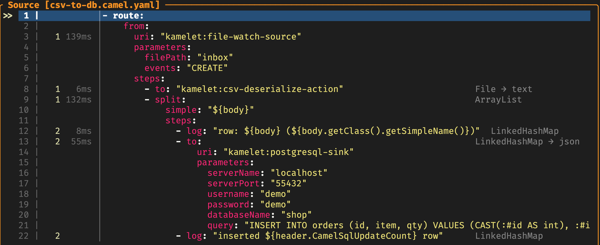

The Kamelet catalog in Camel 4.24 has its biggest overhaul since Kamelets were introduced. Here is a short tour, followed by an example of the new data type handling.

## Every Kamelet is documented

Every Kamelet has a new description: a one-line summary, then what to use it for, its input and output, and its defaults, limits and error behaviour. The descriptions are written for integrators who do not know Camel, and for AI assistants, which often read only the Kamelet YAML. Every fact in them was checked by running the Kamelet.

## Almost every Kamelet is tested

220 of the 236 Kamelets are now tested with [Citrus](https://citrusframework.org/) and Camel CLI, in about 270 tests against real brokers, databases and cloud emulators in containers. The tests found many bugs in the Kamelets and in Camel itself, which are fixed in 4.24.

## Removed and new Kamelets

About 40 Kamelets are removed. Some could no longer work (the Twitter v1.1 API, Dropbox, MinIO), some were little used, and some were variants that the plain Kamelets now cover. For example, the Apicurio Registry variants of the Kafka Kamelets are gone, because the plain Kafka source and sink now take a schema registry.

New Kamelets include:

- `soap-source` and `soap-action`, to serve a SOAP web service from a WSDL
- `debezium-postgresql-source`, the row changes of PostgreSQL tables as they happen
- `openai-chat-action`, to call a chat model of OpenAI or any OpenAI-compatible server, such as Ollama
- `ai-tool-source`, to offer a flow as a tool to AI agents over MCP

There are also sources and sinks for SMB, MLLP and ActiveMQ, actions for CSV and XSLT, and more. New Kamelets start at the *Preview* support level.

## Data types that fit together

Until now, putting two Kamelets one after the other meant knowing what kind of body the first one leaves behind: a stream, a string or a map. That is what this part of 4.24 fixes.

A Kamelet can declare the data type it takes in and the one it gives out, such as `text`, `json` or `binary`. In 4.24 many more Kamelets declare a default data type, and Camel core converts the message body to that type for you. The body a Kamelet receives then has a known type.

As an example, this route loads CSV files into a PostgreSQL table:

```yaml
- route:
    from:
      uri: "kamelet:file-watch-source"
      parameters:
        filePath: "inbox"
        events: "CREATE"
      steps:
        - to: "kamelet:csv-deserialize-action"
        - split:
            simple: "${body}"
            steps:
              - log: "row: ${body} (${body.getClass().getSimpleName()})"
              - to:
                  uri: "kamelet:postgresql-sink"
                  parameters:
                    serverName: "localhost"
                    serverPort: "55432"
                    username: "demo"
                    password: "demo"
                    databaseName: "shop"
                    query: "INSERT INTO orders (id, item, qty) VALUES (CAST(:#id AS int), :#item, CAST(:#qty AS int))"
              - log: "inserted ${header.CamelSqlUpdateCount} row"
```

`csv-deserialize-action` turns the CSV into a list of rows, each a map from column name to value. `postgresql-sink` takes one JSON object and fills the parameters of the SQL from its fields. So after the split, a map goes into a Kamelet that expects JSON.

To try it, start PostgreSQL in a container:

```shell
docker run -d --name shop-db -p 55432:5432 -e POSTGRES_USER=demo -e POSTGRES_PASSWORD=demo -e POSTGRES_DB=shop postgres:17
docker exec shop-db psql -U demo -d shop -c "CREATE TABLE orders (id int primary key, item text, qty int)"
```

Save the route as `csv-to-db.camel.yaml`, run it with `camel run csv-to-db.camel.yaml`, and copy a CSV file into the `inbox` folder. `file-watch-source` only sees files created after it starts.

With this file in the `inbox` folder:

```text
id,item,qty
1,Camel plush,2
2,Kamelet mug,1
```

Camel 4.24 logs:

```text
row: {id=1, item=Camel plush, qty=2} (LinkedHashMap)
inserted 1 row
row: {id=2, item=Kamelet mug, qty=1} (LinkedHashMap)
inserted 1 row
```

and the rows are in the table:

```text
 id |    item     | qty
----+-------------+-----
  1 | Camel plush |   2
  2 | Kamelet mug |   1
```

The [Camel TUI](/blog/2026/07/camel-tui/) shows the body type at each step. Run `camel tui` while the route runs, press `2` for the Source view, and open `csv-to-db.camel.yaml`:



The right column is the Java type of the body when it reached the step. Where a step calls a Kamelet with a data type, an arrow shows what Camel converts the body to first. On line 13, `LinkedHashMap → json` is where each row is turned into JSON before `postgresql-sink` sees it.

### From a LinkedHashMap to JSON

`postgresql-sink` declares the data type it takes:

```yaml
  dataTypes:
    in:
      default: json
      types:
        json:
          format: "application-json"
```

`application-json` is a data type transformer in `camel-jackson3`, which the Kamelet already depends on. Because `json` is the default, Camel runs it on every message before the sink's template sees it:

- a `Map` becomes a JSON object and a `List` a JSON array;
- JSON text, bytes or a stream is kept as is;
- a Jackson JSON node or a POJO is written as JSON.

The result is JSON as bytes, with the `Content-Type` header set to `application/json`. The first row reaches the sink as:

```json
{"id":"1","item":"Camel plush","qty":"2"}
```

In Camel 4.23 the sink does not declare a data type, and the same rows fail on its first step:

```text
org.apache.camel.NoTypeConversionAvailableException: No type converter available to convert from type: java.util.LinkedHashMap to the required type: java.io.InputStream
```

No rows are written. In 4.23 you had to put `json-serialize-action` in front of the sink yourself. You still can in 4.24, but you no longer have to.

One thing to watch: data types do not guess types inside the data. CSV values are text, so `id` and `qty` become JSON strings. PostgreSQL refuses a string for an integer column (`column "id" is of type integer but expression is of type character varying`), which is why the SQL has `CAST(:#id AS int)`.

## Security model and SBOM

If you run Kamelets in production, you want to know what the catalog protects you from and what is up to you. The catalog now has a [security model](/camel-kamelets/next/security-model.html) that says exactly that: what counts as a vulnerability of a Kamelet, and what is the job of the route author and the operator. Following it, many Kamelets now remove incoming Camel headers that could change where they send the message, and secret options are marked as credentials.

The catalog also publishes an SBOM of the libraries the Kamelets pin, such as JDBC drivers. It is checked against [OSV](https://osv.dev/) every week, as Dependabot cannot see versions inside Kamelet YAML.

## Upgrading

Some of these changes are not backwards compatible: removed Kamelets, renamed options, and changed defaults and behaviour, such as the data types above. The [Camel 4.24 upgrade guide](/manual/camel-4x-upgrade-guide-4_24.html) lists them all, with what to use or change instead.

Let us know how the new catalog works for you on the [mailing list](/community/mailing-list/) or in the [Zulip chat](https://camel.zulipchat.com/).
